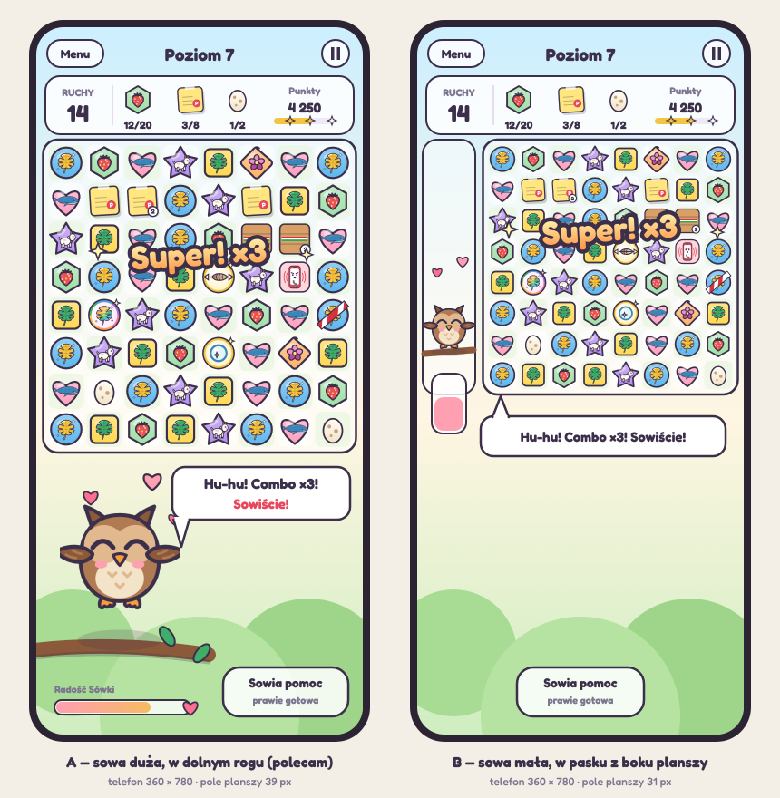
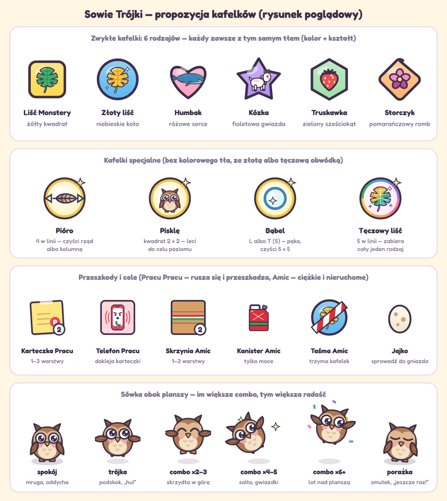

# Analiza 5 — nowa mini-gra „match 3”: Sowie Trójki (dokument projektowy)

> Data: 2026-11-22 · Podstawa: prośba właściciela z 2026-11-22 (dosłownie w [rozdziale 1](#1-prośba-dosłownie-i-numer)),
> przegląd gier Candy Crush Saga, Royal Match i Gardenscapes ([rozdział 2](#2-czego-uczą-candy-crush-saga-royal-match-i-gardenscapes),
> źródła w [Załączniku A](#załącznik-a-źródła)) i kod na `main` (commit `1e45273`) · Status: **projekt zatwierdzony —
> decyzje właściciela z 2026-11-22 w [rozdziale 19](#19-decyzje-właściciela-2026-11-22)** (wszystkie według
> rekomendacji; Sowia Dziupla jako osobna funkcja — [`ANALIZA_7_Sowia_Dziupla.md`](ANALIZA_7_Sowia_Dziupla.md));
> budowa gry (podgląd) to krok 4 kolejności prac, po poprawkach wydajności z Analizy 6, w jednym PR na `main`.
> Druga analiza z tego dnia: [`ANALIZA_6_Wydajnosc_lagi.md`](ANALIZA_6_Wydajnosc_lagi.md) (wydajność) — nowa gra
> korzysta z jej usprawnień od pierwszego dnia. Zasady pracy bez zmian:
> [`ANALIZA_3_Plan_prac.md`, rozdz. 8.1](ANALIZA_3_Plan_prac.md).

Makieta i kafelki w tej analizie to **rysunek poglądowy** zrobiony z istniejących grafik Sowiego Świata (liście,
humbak, kózka, Sówka) i kilku prostych nowych ikon — prawdziwa gra będzie wyglądać podobnie, ale dopracowana.

---

## 0. W skrócie (dla właściciela)

- **Gra:** „Sowie Trójki” — spokojna, kolorowa gra logiczna typu „match 3”: zamieniasz miejscami dwa sąsiednie
  kafelki, żeby ułożyć w rzędzie albo w kolumnie co najmniej trzy takie same. Ułożone znikają, z góry spadają nowe,
  a jeśli same ułożą się w kolejne trójki — jest **combo**. Każdy poziom ma prosty cel (np. „zbierz 20 truskawek”,
  „zerwij 8 karteczek Pracu”) i ograniczoną liczbę ruchów.
- **Sówka stoi z boku planszy na gałęzi i kibicuje:** po każdej trójce podskakuje i pohukuje, przy combo ×2–3 macha
  skrzydłami i mówi „Super!”, przy ×4–5 robi salto z gwiazdkami w oczach, a przy ×6 i więcej wzlatuje nad planszę
  i sypie konfetti. Smuci się tylko na chwilę po przegranej i od razu zachęca: „Spróbujmy jeszcze raz!”. Z radości
  Sówki ładuje się **Sowia pomoc** — kiedy jest pełna, stukasz w Sówkę, a ona przelatuje nad planszą i pomaga.
- **Kafelki:** 6 rodzajów, każdy **zawsze z tym samym tłem w innym kolorze i innym kształcie** — Liść Monstery na
  żółtym kwadracie, Złoty liść na niebieskim kole, Humbak na różowym sercu, Kózka na fioletowej gwieździe, Truskawka
  na zielonym sześciokącie, Storczyk na pomarańczowym rombie. Rodzaju nie da się pomylić nawet bez rozróżniania
  kolorów — wystarczy kształt.
- **Pracu Pracu i Amic przeszkadzają** (karteczki Pracu, dzwoniący telefon Pracu, skrzynie, kanistry i taśma Amic),
  a cele z pisklętami („sprowadź jajka do gniazda — pisklę poleci do Sówki”) dodają czułości.
- **Bez żyć, bez czekania, bez płatności i reklam.** Przegrana = „Spróbuj jeszcze raz” od razu. Tryb Przytulny dla
  dzieci: nie da się przegrać.
- **Na start 45 poziomów** w 3 rozdziałach (Sowia Łąka, Ogródek Sówki, Staw Humbaka), każdy rozdział uczy czegoś
  nowego; trudność ustawiona i sprawdzona komputerowym „graczem-symulatorem”.
- **Gra wchodzi do menu jako szósta karta** („6. Las”), z instrukcją „Jak grać?”, zadaniami Sowiej Akademii,
  rekordami i zapisem w chmurze. **Do zapisu potrzebna jest jedna Twoja czynność** — dopisanie jednego słowa
  w regułach bazy Firestore (instrukcja krok po kroku: [Załącznik B](#załącznik-b-reguły-firestore--co-zmienić-i-jak-to-opublikować)).
- **Plan:** 7 etapów (M0–M7, [rozdział 17](#17-plan-prac)), ok. 3–4 tygodnie pracy; najpierw podgląd do Twoich
  testów, potem karta w menu. **Polecam zacząć po poprawkach wydajności z Analizy 6** (pierwsze kroki W0–W2), żeby
  nowa gra od razu działała płynnie na słabszych telefonach.
- **12 pytań** prostym językiem: [rozdział 18](#18-pytania-do-właściciela-prostym-językiem) (m.in. nazwa, miejsce
  Sówki, kafelki, liczba poziomów, zgoda na zmianę reguł bazy).
- **Decyzje (2026-11-22):** wszystko według rekomendacji — nazwa „Sowie Trójki”, Sówka w dolnym rogu (wariant A),
  kafelki jak na obrazku, bez żyć, 45 poziomów (później „tryb bez końca”), podgląd przed kartą w menu, Tryb
  Przytulny bez przegrywania, głos Sówki jak dziś. **Sowia Dziupla** będzie osobną funkcją zamiast obecnego menu
  (Analiza 7), a **Galeria** urośnie o zdjęcia sów, kóz, wielorybów i roślin ozdobnych. Pełna treść nowych reguł
  Firestore do skopiowania: [Załącznik B](#załącznik-b-reguły-firestore--co-zmienić-i-jak-to-opublikować).
  Szczegóły: [rozdział 19](#19-decyzje-właściciela-2026-11-22).





---

## 1. Prośba (dosłownie) i numer

Numeracja ciągnie się od [`UWAGI_WLASCICIELA.md`](UWAGI_WLASCICIELA.md) (N — nowa gra).

| # | Prośba (dosłownie) |
| --- | --- |
| N1 | „Chciałbym dodać kolejną mini-grę. Byłaby to gra w stylu „match 3 game”. Przykłady takich gier (sprawdź w internecie): Candy Crush Saga, Royal Match, Gardenscapes. Chciałbym, żeby z boku ekranu była sowa i reagowała na postępy gracza. Jak się uda coś połaczyć to ma skakać z radości, wydawać odgłosy itd. Przy combo reakcja sówki ma być radośniejsza. W samej grze możesz użyć już istniejących elementów graficznych (liście, rośliny, humbaki, kozy). Dla przejrzystości niech każdy z rodzajów elementów ma inne tło (kolor plus kształt). Przykładowo jeden rodzaj liści będzie zawsze na tle w kształcie niebieskiego okręgu a inny rodzaj liści będzie zawsze miał tło z żółtego kwadratu. W ten sposób gracz nie pomyli rodzajów roślin. Przygotuj pełną analizę dodania nowej mini-gry. Zapisz jakie mechaniki trzeba wprowadzić, jakie testy wykonać, jakie problemy mogą się pojawić, jakie zmiany w kodzie przygotować. Zdaję się na Ciebie w kwestii tego, jak to ma dokładnie wyglądać i działać. Zrób tak, żeby było stylistycznie było „cute” jak pozostałe gry. Analiza ma być pełnym dokumentem projektowym. Plik z analizą wrzuć na main.” — „Jeżeli będziesz mieć jakieś pytania to napisz je tutaj i w analizie. Pytania zadaj prostym językiem jak dla osoby bez wiedzy informatycznej.” |

Jak spełnia to projekt:

| Wymaganie | Gdzie w projekcie |
| --- | --- |
| gra „match 3” jak Candy Crush, Royal Match, Gardenscapes | rozdz. 2 (co bierzemy), 6 (zasady), 7 (przeszkody i cele), 9 (poziomy) |
| sowa z boku ekranu reaguje na postępy | rozdz. 4 (miejsce Sówki), 8 (wszystkie reakcje) |
| skacze z radości, wydaje odgłosy; przy combo radośniej | rozdz. 8.2 (skala radości 0–5 według combo), 11 (odgłosy Sówki) |
| istniejące grafiki (liście, rośliny, humbaki, kozy) | rozdz. 5 (kafelki: oba liście, humbak i kózka z gotowych rysunków; rośliny jako proste ikony w tym samym stylu) |
| każdy rodzaj z innym tłem (kolor + kształt) | rozdz. 5.1–5.2 i obrazek kafelków |
| „cute” jak pozostałe gry | rozdz. 12 (styl), Sowi Świat z Analizy 2 |
| mechaniki, testy, problemy, zmiany w kodzie | rozdz. 6–11, 15, 16, 14 |
| pytania prostym językiem | rozdz. 18 |

---

## 2. Czego uczą Candy Crush Saga, Royal Match i Gardenscapes

### 2.1. Co mają wspólnego

- **Ruch:** zamiana dwóch sąsiednich kafelków; trzy (lub więcej) takie same w rzędzie albo kolumnie znikają,
  wyżej położone spadają, z góry wpadają nowe; kolejne dopasowania „same z siebie” to kaskady (combo) i dają więcej
  punktów (Candy Crush Saga — Wikipedia).
- **Kafelki specjalne z większych dopasowań:** 4 w linii czyszczą rząd albo kolumnę (Candy Crush: cukierek
  w paski, Royal Match: rakieta), kształt L albo T z 5 kafelków wybucha wokół (Candy Crush: cukierek w papierku,
  Royal Match: TNT — promień 2 pól), 5 w linii zabiera cały jeden kolor (Candy Crush: kolorowa bomba, Royal Match:
  kula światła); Royal Match ma jeszcze śmigiełko z kwadratu 2 × 2, które leci w „strategiczne” miejsce.
- **Połączenia mocy:** dwie moce zamienione ze sobą dają większy efekt — np. dwie rakiety: rząd i kolumna naraz;
  kula światła z inną mocą zamienia najczęstszy kolor w tę moc; dwie kule (dwie kolorowe bomby) czyszczą całą
  planszę.
- **Poziomy z celem i limitem ruchów**, przeszkody (galaretka, lukrecja, czekolada, skrzynie, wazony), na końcu
  poziomu pozostałe ruchy zamieniają się w premię (w Candy Crush to słynny „Sugar Crush”), gwiazdki za punkty.
- **Pomocnicy (boostery):** młotek na jedno pole, strzała na rząd, armata na kolumnę, „czapka błazna” mieszająca
  planszę — w Royal Match ich użycie **nie zabiera ruchu**.
- **Opowieść i postać:** w Royal Match Król Robert odnawia zamek, w Gardenscapes kamerdyner Austin odnawia ogród
  dworu — za gwiazdki z poziomów. W Candy Crush przez jakiś czas był nawet tryb z sową Odus („Dreamworld”).

### 2.2. Porównanie

| | Candy Crush Saga | Royal Match | Gardenscapes |
| --- | --- | --- | --- |
| Postać | Tiffi i pan Toffee (narratorzy) | Król Robert odnawia zamek | kamerdyner Austin odnawia ogród |
| Moce z dopasowań | paski (4), papierek (L/T), kolorowa bomba (5) | rakieta (4), TNT (L/T), śmigiełko (2 × 2), kula światła (5) | petarda, bomba, dynamit, tęczowa moc |
| Cele | galaretka, składniki na dół, punkty, zamówienia | wazony, skrzynie, jajka i inne | zadania ogrodu, różne elementy |
| Ruchy na poziom (szacunkowo) | zwykle kilkanaście–kilkadziesiąt | zwykle kilkanaście–30 | zwykle kilkanaście–30 |
| Życia | 5, jedno wraca co 30 min | 5, wracają z czasem | są |
| Płatności | sztabki złota (życia, ruchy, pomoce) | monety, pomoce | monety, pomoce |
| Poziomów | tysiące, odcinki po 15 | ponad 12 400 (XI 2025), nowe co 2 tygodnie | tysiące |

### 2.3. Wnioski projektantów (do zastosowania u nas)

- **Mało elementów naraz:** najwyżej 3–4 rodzaje przeszkód na poziomie — więcej „zaczyna wyglądać chaotycznie”
  (Playrix, twórcy Gardenscapes). Nowe elementy wprowadzać po jednym, na początku częściej, potem rzadziej.
- **Każdy poziom do przejścia bez pomocy** i z jednym pomysłem (Playrix).
- **Trudność mierzona odsetkiem przegranych**, z celem na poziom (np. 80% wygranych); **nie układać kilku trudnych
  poziomów z rzędu** — to zniechęca (Playrix opisuje serię poziomów z 92–95% przegranych jako błąd).
- **15–20 ruchów to dziś standard**, na pierwszych poziomach można dać mniej albo więcej i sprawdzić (Gamigion);
  ostrzeżenie: dwa przetasowania planszy w jednym podejściu to znak źle ustawionego poziomu.
- **Mniej mocy na pierwszych poziomach** ułatwia wyważenie trudności (badanie z konferencji CoG 2024).
- **Jasny cel, prosty wygląd, powoli rosnąca trudność, nagroda, która cieszy** (GameAnalytics); dźwięk i animacja
  muszą odpowiadać na każdy ruch — to one dają przyjemność z gry (przegląd mechanik gier „match”).
- **Rozróżnianie kafelków kształtem, nie tylko kolorem** — dobre gry z tego gatunku dają każdemu kolorowi własny
  symbol, bo filtr kolorów nie wystarcza osobom z zaburzeniami widzenia barw.

### 2.4. Czego nie bierzemy

- **Żyć i czekania**, płatności, reklam, „okazji”, liczników presji — to rodzinna gra bez sklepu.
- **Nazw, grafik, poziomów, muzyki i dźwięków** tych gier — bierzemy tylko mechaniki typowe dla gatunku; wszystko
  inne jest z Sowiego Świata (Sówka, liście Monstery, humbak, kózki, Pracu Pracu, Amic) i nazywa się po swojemu
  (Pióro, Pisklę, Bąbel, Tęczowy liść, Sowia pomoc, Humbaczy Finał).
- **Trybu na czas** (odliczanie sekund) — w pierwszej wersji tylko ruchy, bez pośpiechu.

---

## 3. Pomysł na grę

**Sowie Trójki** to gra logiczna „match 3” w Sowim Lesie. Sówka siedzi na gałęzi obok planszy i przeżywa każdy
Twój ruch. Na planszy są liście, humbaki, kózki, truskawki i storczyki — każdy rodzaj na własnym, kolorowym tle.
Układasz trójki, robisz moce i combo, zrywasz karteczki Pracu Pracu, rozbijasz skrzynie Amic i sprowadzasz jajka
do gniazda, żeby pisklęta mogły polecieć do Sówki.

**Pętla gry:**

```
mapa poziomów ──► poziom: cel + ruchy ──► zamiany, combo, moce ──► Sówka się cieszy, ładuje się Sowia pomoc
     ▲                                                                       │
     │                                cel zrobiony? ── tak ──► Humbaczy Finał (zostałe ruchy = premia) ──► 1–3 gwiazdki
     │                                     │ nie, ruchy się skończyły
     └──── następny poziom ◄───────────────┴──► „Spróbuj jeszcze raz” (od razu, bez czekania)
```

- **Jeden poziom:** 1–3 minuty — w sam raz na krótką chwilę z telefonem (Analiza 2, rozdz. 2.5).
- **Co jakiś czas nowość:** nowa moc, przeszkoda albo cel (pierwszy raz zawsze na łatwym poziomie z podpowiedzią),
  co 15 poziomów nowy rozdział z nowym tłem i muzyką.
- **Długi cel:** gwiazdki (zbierane do zadań Akademii i — w drugim etapie — do urządzania kącika Sówki).

---

## 4. Ekran gry

### 4.1. Telefon w pionie (podstawa)

Na telefonie w pionie brakuje miejsca na szerokość, a jest go dużo na wysokość. Dlatego proponuję **wariant A**:
plansza na całą szerokość (8 kolumn), a **Sówka duża, z boku — w dolnym rogu na gałęzi wychodzącej z krawędzi
ekranu**, obok niej dymek z jej słowami, pasek „Radość Sówki” i przycisk „Sowia pomoc”. Wariant B (wąski pasek
z Sówką obok planszy) zmniejsza pola planszy o ok. 20% (na telefonie 360 px: 31 px zamiast 39 px) i Sówka jest
mała — przy tym trudniej zobaczyć jej radość. Wybór należy do Ciebie (pytanie 2).

```
┌──────────────────────────────┐  ← bezpieczny obszar (wycięcie ekranu)
│ [Menu]     Poziom 7       ⏸  │  pasek: menu, numer poziomu, pauza
│ ┌──────────────────────────┐ │
│ │RUCHY│ 🍓12/20 📝3/8 🥚1/2 │ │  ruchy, cele (z obrazkiem i licznikiem), punkty
│ │ 14  │        Punkty 4 250 ★★☆│ │  z paskiem gwiazdek
│ └──────────────────────────┘ │
│ ┌──────────────────────────┐ │
│ │ ■ ● ♥ ★ ■ ◆ ♥ ●           │ │
│ │ ♥ 📝 📝 ● ★ 📝 ■ ⬢        │ │  plansza 8 × 8 (do 8 × 9)
│ │ ★ ■ ● ⬢ ■ 📦 📦 ♥          │ │  pole 36–47 px (zależnie od telefonu)
│ │ …    „Super! ×3”          │ │
│ └──────────────────────────┘ │
│          ╭───────────────╮   │
│   (^v^)  │ Hu-hu! ×3!     │   │  dymek Sówki
│  /(   )\ ╰───────────────╯   │
│ ══╧═╧══ gałąź               │  Sówka (ok. 130 px wysokości) — z boku, na gałęzi
│ Radość Sówki ▓▓▓▓▓░░ ♥  [Sowia pomoc] │  pasek radości i przycisk (strefa kciuka)
└──────────────────────────────┘
```

| Telefon (szerokość × wysokość w px CSS) | Pole planszy (8 kolumn) | Plansza | Miejsce na Sówkę pod planszą |
| --- | --- | --- | --- |
| 320 × 568 (najmniejszy, np. iPhone SE 1. gen.) | 36 px | 8 × 8 | ok. 120 px — Sówka mniejsza (ok. 90 px), dymek nad nią |
| 360 × 800 (popularne Androidy) | 39–40 px | 8 × 9 | ok. 280 px |
| 390 × 844 (iPhone 13–15) | 43 px | 8 × 9 | ok. 290 px |
| 430 × 932 (duże telefony) | 47 px | 8 × 9 | ok. 330 px |

- Pole 36 px na najmniejszym telefonie jest mniejsze niż zwykłe minimum przycisku (44–48 px), ale tu nie trzeba
  celować w środek — wystarczy **dotknąć kafelka gdziekolwiek i przesunąć palec w stronę sąsiada** (próg ok. 1/3
  pola). Dwa stuknięcia (zaznacz, potem sąsiad) też działają.
- Plansza ma zawsze 8 kolumn; liczba rzędów i kształt (dziury, wycięcia) zależą od poziomu.

### 4.2. Telefon poziomo, tablet, komputer

Sówka **dosłownie z boku**: kolumna po lewej (Sówka na gałęzi, dymek, Radość Sówki, Sowia pomoc), plansza na środku,
cele i ruchy w kolumnie po prawej. Na telefonie poziomo pole planszy ok. 34 px (9 rzędów na 390 px wysokości).
Tablet i komputer — wszystko większe, tło Sowiego Lasu po bokach (jak w innych grach).

### 4.3. Pozostałe ekrany

- **Mapa poziomów** („Ścieżka przez Sowi Las”): kręta ścieżka (jak w menu) z kółkami poziomów, przy każdym gwiazdki
  (☆☆☆); bieżący poziom pulsuje, a obok stoi mała Sówka. Rozdziały różnią się tłem (łąka, ogródek, staw).
  Przewijanie w pionie, przycisk „Graj” otwiera bieżący poziom.
- **Okno startu poziomu:** cel obrazkami i słowami („Zbierz 20 truskawek”), liczba ruchów, gwiazdki z poprzednich
  podejść, „Graj”.
- **Wygrana:** Sówka tańczy, gwiazdki wskakują po kolei (z dźwiękiem), punkty, „Dalej” / „Mapa”; za pierwsze
  trzy gwiazdki — konfetti.
- **Przegrana:** Sówka smutnieje na chwilę i od razu zachęca; „Spróbuj jeszcze raz” (duży przycisk) i „Mapa”;
  pokazuje, ile brakowało („Brakowało 3 truskawek!”).
- **Pauza:** wspólne menu pauzy SowieGry (`shared/ui/pause-menu.js`: Wznów, Zacznij od nowa, Jak grać, Ustawienia,
  Garderoba, Wyjdź do menu).

---

## 5. Kafelki

### 5.1. Sześć rodzajów

| # | Rodzaj | Obrazek | Tło: kształt | Tło: kolor | Skąd grafika |
| --- | --- | --- | --- | --- | --- |
| 1 | Liść Monstery | zielony liść z wycięciami | kwadrat z zaokrąglonymi rogami | żółty | `assets/svg/liscie/zielony.svg` (bez zmian) |
| 2 | Złoty liść | złoty liść | koło | niebieski | `assets/svg/liscie/zloty.svg` (bez zmian) |
| 3 | Humbak | niebieski humbak | serce | różowy | `assets/svg/humbak/humbak.svg` (bez zmian) |
| 4 | Kózka | biała kózka | gwiazda (5 ramion) | fioletowy | `assets/svg/kozki/koza.svg` (bez zmian) |
| 5 | Truskawka | czerwona truskawka z szypułką | sześciokąt (plaster miodu) | zielony | nowa prosta ikona SVG, wzorowana na Truskawce z Łącz i Hoduj |
| 6 | Storczyk | różowy kwiat storczyka | romb | pomarańczowy | nowa prosta ikona SVG, wzorowana na Storczyku z Łącz i Hoduj |

- Dwa rodzaje liści dokładnie jak w Twoim przykładzie (liść na żółtym kwadracie, drugi liść na niebieskim kole).
- **Dlaczego truskawka i storczyk, a nie rysunki roślin wprost z innych gier:** rośliny z Łącz i Hoduj i Sowich
  Ogrodów rysują się w doniczkach i w polu 36–40 px są za małe i zbyt szczegółowe (sprawdziłem na arkuszu próbnym).
  Truskawka i storczyk mają prosty, wyraźny kształt i kolory, których nie ma u innych kafelków (czerwony, różowy).
  Ikony narysuję w tym samym stylu (gruby kontur `#3b2f4a`, duże plamy koloru).
- Humbak i kózka jako zwykłe kafelki — tak jak zaproponowałeś. W Sowim Świecie kózki są „mocami”, a humbak
  „bonusem”, więc **moce w tej grze mają inne obrazki** (Pióro, Pisklę, Bąbel, Tęczowy liść — rozdz. 6.5), a humbak
  zostaje też gwiazdą finału poziomu („Humbaczy Finał”). Jeśli wolisz kózkę i humbaka tylko jako moce, zamienię je
  na dwie inne rośliny (pytanie 3).

### 5.2. Czytelność

- **Kształt + kolor + obrazek:** trzy niezależne wskazówki. Kształty tła są tak różne (koło, kwadrat, romb, serce,
  gwiazda, sześciokąt), że wystarczy sam obrys — rodzaj da się rozpoznać nawet na wydruku czarno-białym.
- **Wygląd tła:** delikatny gradient (jaśniejszy u góry), błysk w lewym górnym rogu, cień pod spodem, kontur
  `#3b2f4a` ok. 2,5 px (jak w całym Sowim Świecie — Analiza 2, rozdz. 2.3); obrazek zajmuje ok. 60% pola.
- **Sprawdzenie:** zrzut planszy w odcieniach szarości i w trzech symulacjach zaburzeń widzenia barw (deuteranopia,
  protanopia, tritanopia) — każdy rodzaj musi się różnić kształtem; test automatyczny pilnuje, że każdy rodzaj ma
  inny kształt i inny kolor tła, a różnica jasności tła i obrazka jest wystarczająca (rozdz. 15.6).
- **Ile rodzajów naraz:** mniej rodzajów = łatwiej i więcej kaskad. Poziomy 1–8 — 4 rodzaje, 9–20 — 5,
  od 21 — 5 albo 6 (zależnie od poziomu).

### 5.3. Kafelki specjalne (moce) — wygląd

Moce **nie mają kolorowego tła-kształtu**, tylko jasną, błyszczącą „bańkę” ze złotą obwódką (Tęczowy liść —
z tęczową) i iskierką; lekko pulsują. Dzięki temu od razu widać, że to coś innego niż zwykły kafelek.

| Moc | Obrazek |
| --- | --- |
| Pióro | sowie pióro ze strzałkami ↔ albo ↕ (kierunek lotu) |
| Pisklę | malutka Sówka (w kolorach wybranego w Butiku gatunku) |
| Bąbel | duży bąbel (jak bąbelki z garderoby) z iskierką |
| Tęczowy liść | `assets/svg/liscie/teczowy.svg` w tęczowej obwódce |

---

## 6. Zasady gry

### 6.1. Ruch

- Zamiana dwóch sąsiednich kafelków (nie po skosie): przesunięcie palcem z kafelka w stronę sąsiada (od 1/3 pola,
  kierunek według przeważającej osi) albo dwa stuknięcia. Na komputerze także myszą, a z klawiatury: strzałki +
  Spacja (zaznacz) + strzałka (zamień) — Analiza 2, rozdz. 2.5.
- **Zamiana bez dopasowania** — kafelki wracają na miejsce, ruch nie przepada (Sówka przechyla głowę „Hm?”).
- Kafelki w taśmie Amic i przeszkody się nie ruszają (lekkie drgnięcie i dźwięk „bonk”).
- W trakcie spadania i kaskad plansza nie przyjmuje ruchów (zwykle 0,5–2 s); można stuknąć, żeby przyspieszyć.

### 6.2. Dopasowania

| Ułożenie | Efekt |
| --- | --- |
| 3 w rzędzie albo kolumnie | znikają |
| 4 w linii | znikają, w ich miejscu powstaje **Pióro** (kierunek jak linia) |
| kwadrat 2 × 2 | znikają, powstaje **Pisklę** |
| L, T albo + (5 lub więcej, w obu kierunkach) | znikają, powstaje **Bąbel** |
| 5 (lub więcej) w jednej linii | znikają, powstaje **Tęczowy liść** |

- Pierwszeństwo, gdy jedno ułożenie pasuje do kilku: Tęczowy liść > Bąbel > Pióro > Pisklę > zwykłe.
- **Gdzie powstaje moc:** na polu kafelka, który przesunąłeś (jeśli jest w ułożeniu); w kaskadzie — na polu
  najbliżej środka ułożenia (przy remisie: niżej, potem bardziej w lewo) — zawsze tak samo, więc da się to
  przewidzieć i przetestować.
- Każde ułożenie uszkadza przeszkody **obok** siebie (karteczki, skrzynie, telefony) — każdą najwyżej raz na
  ułożenie.

### 6.3. Spadanie, nowe kafelki, combo

- Po zniknięciu kafelki nad pustym polem spadają w dół; jeśli pod przeszkodą albo dziurą zostanie puste pole,
  kafelek zsuwa się do niego **ukosem** z sąsiedniej kolumny (inaczej takie pola zostałyby puste na zawsze).
- Nowe kafelki wpadają z góry każdej kolumny („wylot” — w poziomie oznaczony; zwykle górny rząd).
- **Combo:** każde kolejne dopasowanie, które powstało samo po spadnięciu, podnosi licznik combo (×2, ×3, …).
  Napis nad planszą: „Ładnie!” (×2), „Super!” (×3), „Ekstra!” (×4), „Sowiście!” (×5), „Hu-hu-hura!” (×6 i więcej).

### 6.4. Punkty

| Co | Punkty |
| --- | --- |
| każdy kafelek zbity dopasowaniem | 20 × numer kaskady (w kaskadzie ×2 — 40 za kafelek itd.) |
| powstanie mocy | Pióro 60, Pisklę 60, Bąbel 120, Tęczowy liść 200 |
| kafelek zbity mocą | 20 |
| warstwa przeszkody | 50 |
| jajko w gnieździe | 500 |
| Humbaczy Finał | każdy pozostały ruch = Pióro odpalone w losowym miejscu (+ punkty za zbite kafelki) + 100 |

Punkty decydują tylko o gwiazdkach (rozdz. 6.9) — do wygranej wystarczy cel.

### 6.5. Moce

| Moc | Jak powstaje | Co robi |
| --- | --- | --- |
| **Pióro** | 4 w linii | przelatuje przez cały rząd (↔) albo kolumnę (↕) i zbija wszystko na drodze (przeszkody — po warstwie) |
| **Pisklę** | kwadrat 2 × 2 | zbija 4 sąsiednie pola, wzlatuje i leci do pola, które najbardziej pomoże w celu (karteczka, skrzynia, potrzebny rodzaj kafelka, pole pod jajkiem), tam zbija je i 4 sąsiednie |
| **Bąbel** | L, T, + (5) | pęka z pluskiem i zbija kwadrat 5 × 5 wokół siebie |
| **Tęczowy liść** | 5 w linii | zamieniony z kafelkiem zbija **wszystkie** kafelki tego rodzaju na planszy |

- **Uruchomienie:** zamianą z sąsiadem albo **stuknięciem** (wygodne dla dzieci) — jedno i drugie zabiera ruch.
  Stuknięty Tęczowy liść zabiera najliczniejszy rodzaj.
- Moc trafiona przez inną moc odpala się sama (reakcja łańcuchowa — liczy się do combo).

### 6.6. Połączenia mocy (zamiana dwóch mocy)

| Połączenie | Efekt |
| --- | --- |
| Pióro + Pióro | krzyż: cały rząd i cała kolumna |
| Pióro + Bąbel | gruby krzyż: 3 rzędy i 3 kolumny |
| Bąbel + Bąbel | wielki plusk: kwadrat 7 × 7 |
| Pisklę + Pisklę | trzy pisklęta lecą do trzech różnych celów |
| Pisklę + Pióro / Bąbel | pisklę zanosi pióro albo bąbel do celu i tam je odpala |
| Tęczowy liść + Pióro / Bąbel / Pisklę | wszystkie kafelki najliczniejszego rodzaju zamieniają się w tę moc i odpalają po kolei |
| Tęczowy liść + Tęczowy liść | cała plansza: wszystkie kafelki i po jednej warstwie każdej przeszkody |

### 6.7. Brak ruchów

Jeśli na planszy nie ma żadnej zamiany dającej dopasowanie, **Sówka miesza planszę** (obraca się i mówi
„Pomieszam!”) — bez kary i bez zabierania ruchu. Po pomieszaniu zawsze jest co najmniej jeden ruch i żadne
dopasowanie nie znika „samo”.

### 6.8. Podpowiedź

Po 5 s bez ruchu (w Trybie Przytulnym po 3 s) Sówka przechyla głowę, a potem pokazuje skrzydłem stronę planszy,
gdzie jest dobry ruch; dwa kafelki delikatnie się kołyszą. Podpowiedź wybiera ruch pomagający w celu albo dający
moc, a nie przypadkowy.

### 6.9. Koniec poziomu i gwiazdki

- **Wygrana:** wszystkie cele zrobione (od razu, nawet jeśli zostały ruchy) → Humbaczy Finał → wyniki.
- **Gwiazdki:** ★ za wygraną, ★★ i ★★★ za punkty powyżej progów (progi ustawione symulatorem: ★★ — typowy wynik,
  ★★★ — bardzo dobry; rozdz. 15.2). Na pasku punktów widać, ile brakuje do następnej gwiazdki.
- **Przegrana:** ruchy się skończyły, a cel nie jest zrobiony. **Prezent od Sówki:** raz na podejście, jeśli cel jest
  zrobiony co najmniej w 75%, Sówka daje 3 dodatkowe ruchy („Prawie! Masz ode mnie 3 ruchy!”). Potem „Spróbuj jeszcze
  raz” — od razu, bez żyć i czekania.
- **Tryb Przytulny** (ustawienie z menu): gdy ruchy się kończą, Sówka zawsze dokłada 5 — nie da się przegrać
  (gwiazdki liczone tak samo, więc trzy gwiazdki wymagają dobrej gry).

### 6.10. Humbaczy Finał

Po wygranej humbak wyskakuje z wody nad planszą, a każdy pozostały ruch zamienia się w Pióro, które od razu leci
(punkty, plusk, dźwięk). Stuknięcie przyspiesza finał. To nasza wersja „premii za ruchy” i zarazem humbak
w roli bonusu — jak we wszystkich grach Sowiego Świata (Analiza 2, rozdz. 2.1).

---

## 7. Przeszkody, cele i jajka

### 7.1. Przeszkody (Pracu Pracu — ruchome i zaskakujące, Amic — ciężkie i nieruchome)

| Przeszkoda | Wygląd | Zachowanie | Jak usunąć | Od poziomu |
| --- | --- | --- | --- | --- |
| **Karteczka Pracu** | żółta karteczka z czerwoną pieczątką „P” (jak w Łącz i Hoduj), cyfra = warstwy | zajmuje pole, nie spada; 1–3 warstwy | ułożenie obok albo moc: −1 warstwa | 4 |
| **Skrzynia Amic** | drewniana skrzynia z biało-czerwono-zielonym pasem, cyfra = warstwy | zajmuje pole, nie spada; 1–3 warstwy; czasem w środku iskierka (+radość Sówki) | ułożenie obok albo moc: −1 warstwa | 8 |
| **Taśma Amic** | biało-czerwona taśma na kafelku | kafelka nie można przesunąć, ale może być częścią ułożenia zrobionego innymi | ułożenie z jego udziałem albo moc — taśma pęka, kafelek zostaje wolny | 13 |
| **Kanister Amic** | czerwony kanister (`assets/svg/amic/kanister.svg`) | zajmuje pole, nie spada | **tylko moce** (zwykłe ułożenie obok nic nie robi) | 19 |
| **Telefon Pracu** | dzwoniący telefon Pracu (`assets/svg/pracu/telefon.svg`) na różowym polu | jeśli w ruchu nie trafisz żadnej karteczki ani telefonu, telefon dzwoni i **przykleja nową karteczkę** na sąsiednim kafelku (jak rozlewająca się czekolada w Candy Crush) | 2 trafienia obok albo moc | 25 |
| **Dymek Pracu** (drugi etap) | szary dymek „Pracu pracu!” na kafelku | zasłania, jaki to rodzaj (widać „?”) | ułożenie obok odsłania kafelek | później |

### 7.2. Cele

| Cel | Przykład | Uwagi |
| --- | --- | --- |
| Zdobądź punkty | „Zdobądź 1 500 punktów” | tylko pierwsze poziomy |
| Zbierz kafelki | „Zbierz 20 truskawek” | „zamówienie sąsiadki” — obrazek kafelka i licznik |
| Zerwij karteczki | „Zerwij 8 karteczek Pracu” | liczą się warstwy albo całe karteczki (w poziomie zawsze napisane) |
| Rozbij skrzynie | „Rozbij 6 skrzyń Amic” | |
| Wyłącz telefony | „Wyłącz 2 telefony Pracu” | |
| Sprowadź jajka | „Sprowadź 2 jajka do gniazda” | rozdz. 7.3 |

Najwyżej 3 cele naraz i najwyżej 3–4 rodzaje elementów (przeszkód i celów) na poziomie (rozdz. 2.3).

### 7.3. Jajka i pisklęta

Jajko leży na planszy jak kafelek: spada, gdy pod nim jest puste pole, ale nie da się go ułożyć w trójkę ani
zbić. Gdy dotrze do pola z gniazdem w dolnym rzędzie, **wykluwa się pisklę i leci do Sówki** — Sówka przytula je
skrzydłami (serduszka, ciepłe „hu-hu”). To najbardziej „sowi” cel w grze i najładniejsza reakcja.

---

## 8. Sówka z boku — reakcje

### 8.1. Zasady

1. **Zawsze życzliwa:** nigdy nie gani; po przegranej smutek trwa ok. 1 s, potem zachęta.
2. **Radość rośnie z combo** — im dłuższa kaskada i im silniejsza moc, tym większa reakcja (8.2).
3. **Nie przeszkadza w grze:** stoi obok planszy, nie zasłania pól, nie łapie dotyku przeznaczonego dla planszy;
   wielki lot (poziom 5) trwa najwyżej 2 s i odbywa się nad planszą, gdy plansza i tak nie przyjmuje ruchów.
4. **Nie męczy:** dymek najwyżej raz na 2 s, ten sam tekst nie dwa razy z rzędu, „hu!” przy zwykłej trójce cicho
   i najwyżej co 1,5 s; duże reakcje — najwyżej jedna na ruch (najlepsza z całej kaskady).
5. **Ta sama Sówka co wszędzie:** gatunek i strój z Sowiego Butiku i Garderoby (bez wybranego stroju — bez
   dodatków), ten sam wygląd i mruganie co w menu i innych grach (`shared/world/owl.js`).

### 8.2. Skala radości

| Poziom | Kiedy | Ruch Sówki | Oczy | Dźwięk | Dymek | Efekty |
| --- | --- | --- | --- | --- | --- | --- |
| 0 — spokój | nic się nie dzieje | oddycha, mruga, wodzi wzrokiem za palcem; co 8–12 s drapie się skrzydłem albo przeciąga | zwykłe | — | — | — |
| 1 — trójka | zwykłe dopasowanie | mały podskok (ok. 8% wzrostu) | na chwilę radosne | ciche „hu!” | — | 2–3 listki |
| 2 — ładnie | combo ×2, powstała moc, 4 w linii | skok ze skrzydłami w górę (pozycja „radość”) | radosne | „hu-hu!” | „Ładnie!”, „Brawo!” | iskierki |
| 3 — super | combo ×3, Bąbel, cel zrobiony | podwójny skok, machanie skrzydłami | radosne | wesołe „hu-hu-hu” | „Super!”, „Ale combo!” | serduszka |
| 4 — ekstra | combo ×4–5, Tęczowy liść, połączenie dwóch mocy | **salto** w powietrzu | **gwiazdki w oczach** (nowy rysunek oczu) | podekscytowany trel | „Ekstra!”, „Sowiście!” | gwiazdki, małe konfetti przy Sówce |
| 5 — hu-hu-hura | combo ×6+, dwa Tęczowe liście, wielki plusk | **wzlatuje z gałęzi, robi pętlę nad planszą** i wraca | gwiazdki / serduszka w oczach | fanfara + „hu-hu-hura!” | „Hu-hu-hura!”, „Niesamowite!” | deszcz konfetti nad planszą, lekki błysk |

Reakcja może „urosnąć” w trakcie kaskady (np. z 2 na 4, gdy combo dojdzie do ×4), ale nie maleje przed końcem ruchu.

### 8.3. Pozostałe reakcje

| Sytuacja | Reakcja |
| --- | --- |
| zamiana bez dopasowania | przechyla głowę, „Hm?” (raz na kilka prób, nie za każdym razem) |
| brak ruchów — mieszanie | obraca się wokół siebie, „Pomieszam!” |
| zostały 3 ruchy | przestępuje z nogi na nogę, kropelka potu, „Ojej, mało ruchów!” (raz na poziom) |
| cel zrobiony w połowie / prawie | pochyla się do przodu, „Jeszcze trochę!” |
| jeden z celów skończony | kciuk w górę skrzydłem, „Jest!” |
| jajko w gnieździe | pisklę leci do Sówki, przytulenie, serduszka, „Moje pisklątko!” |
| Humbaczy Finał | Sówka klaszcze skrzydłami, otrząsa się z kropli po plusku humbaka |
| wygrana | taniec (podskoki na zmianę z obrotem); przy 3 gwiazdkach — dodatkowe konfetti i „Trzy gwiazdki!” |
| przegrana | zamyka oczy, opuszcza skrzydła (1 s), potem „Spróbujmy jeszcze raz! Hu-hu!” |
| prezent od Sówki (+3 ruchy) | wyciąga skrzydło z prezentem, „Masz ode mnie 3 ruchy!” |
| podpowiedź (5 s bez ruchu) | przechyla głowę „myśli”, potem pokazuje skrzydłem |
| 40 s bez ruchu | zasypia (zamknięte oczy, „zzz”); dotknięcie planszy budzi ją podskokiem |
| stuknięcie w Sówkę | chichocze i robi obrót; gdy Sowia pomoc jest pełna — uruchamia ją |
| początek poziomu | macha skrzydłem, mówi cel („Zbierzmy 20 truskawek!”) |

### 8.4. Radość Sówki i Sowia pomoc

- **Pasek „Radość Sówki”** (pod Sówką) napełnia się z każdym ułożeniem: +1 za kafelek × numer kaskady, +5 za
  powstałą moc, +8 za odpaloną moc, +12 za połączenie mocy. Pełny = 100.
- Gdy pasek jest pełny, Sówka świeci i macha: „Mogę pomóc!”. **Stuknięcie w Sówkę albo w przycisk „Sowia pomoc”**
  — Sówka przelatuje nad planszą i zrzuca **3 Pióra** w miejscach najbardziej pomocnych dla celu. **Nie zabiera
  ruchu** (jak pomocnicy w Royal Match). Pasek wraca do zera.
- To łączy reakcje Sówki z grą: im lepiej grasz (combo), tym szybciej Sówka pomaga — i zamiast zwykłych
  „boosterów” ze sklepu mamy pomocnika-przyjaciela.
- Każdy poziom zaczyna z pustym paskiem; pasek nie przechodzi między poziomami.

### 8.5. Teksty dymków

Krótkie, ciepłe, po polsku, z wykrzyknikiem, bez zdrobnień przesadzonych i bez ocen gracza. Pula (losowanie bez
powtórzeń z rzędu): „Ładnie!”, „Brawo!”, „Super!”, „Ale combo!”, „Ekstra!”, „Sowiście!”, „Hu-hu-hura!”,
„Niesamowite!”, „Jeszcze trochę!”, „Jest!”, „Hm?”, „Pomieszam!”, „Ojej, mało ruchów!”, „Mogę pomóc!”, „Spróbujmy
jeszcze raz!”, „Trzy gwiazdki!”. Teksty w jednym pliku danych, żeby łatwo je zmieniać (i dopisać Twoje propozycje).

### 8.6. Ustawienia i dostępność

- **„Komentarze sowy”** (istniejące ustawienie `settings.quips`): wyłączone — Sówka dalej się rusza, ale bez dymków.
- **Dźwięk:** głośność efektów z menu; odgłosy Sówki to osobna grupa w pliku dźwięków, ciszej niż efekty planszy.
- **Ograniczenie ruchu** (system albo „Efekty” w menu): bez salta, lotu, wstrząsów i deszczu konfetti — Sówka
  reaguje oczami, małym podskokiem i dymkiem.
- **Czytnik ekranu:** opisy w `aria-live` tylko dla ważnych rzeczy (cel zrobiony, wygrana, przegrana, podpowiedź),
  nie dla każdego „hu!”.

### 8.7. Jak to zrobić technicznie

- **Reżyser reakcji** (`SowieTrojki/owl-director.js`) — czysta logika bez rysowania: dostaje zdarzenia gry
  (`match`, `cascade`, `special`, `combo`, `goal`, `invalid`, `shuffle`, `lowMoves`, `win`, `lose`, `idle`, `tap`…),
  liczy poziom radości i zwraca polecenia: `{ reakcja, czas, priorytet, dźwięk, dymek, efekty }`. Kolejka
  z priorytetami: ważniejsza reakcja przerywa słabszą, słabsza nie przerywa ważniejszej, a każda ma minimalny czas
  trwania i przerwę „odpoczynku”. Wszystko na podawanym czasie (testy bez czekania na klatki).
- **Rysowanie Sówki** (`SowieTrojki/owl-view.js`): wspólne `drawOwl` z atlasu (gatunek z Butiku przez
  `linkSpecies`, strój z Garderoby) + własne przekształcenia: podskok (przesunięcie i „squash & stretch”), salto
  (obrót 360° w powietrzu), lot (ścieżka po krzywej nad planszą), drżenie, przechylenie głowy.
- **Nowe pozy** (bez zmiany wyglądu w innych grach): zdefiniowane w katalogu tej gry z wspólnej funkcji `owlLayers`
  — „machanie” (dwie klatki skrzydeł), „wskazuje” (jedno skrzydło w bok — wymaga małej, dodatkowej opcji osobnych
  kątów lewego i prawego skrzydła w `owlLayers`; dotychczasowe pozy bez zmian), „smutek”, „sen”, „zachwyt”.
- **Nowe oczy (3 małe pliki SVG** w `assets/svg/sowa/`): `oczy-gwiazdki.svg`, `oczy-serduszka.svg`,
  `oczy-smutne.svg` — w tym samym pudełku 128 × 128 co obecne oczy, więc pasują do każdego gatunku sowy.
- **Dymek** — zwykły element strony (CSS, czcionka Fredoka), nie rysunek na płótnie: tani, ostry i dostępny.
- **Efekty** (serduszka, gwiazdki, konfetti, „zzz”, kropelka) — wspólna pula cząsteczek silnika
  (`shared/engine/particles.js`) z limitem zależnym od automatu płynności (Analiza 6, W1).

---

## 9. Poziomy i postęp

### 9.1. Mapa i rozdziały

| Rozdział | Poziomy | Tło i muzyka | Nowości |
| --- | --- | --- | --- |
| 1. Sowia Łąka | 1–15 | łąka z kwiatami, dzień | zamiana, moce, combo, karteczki, skrzynie, jajka, taśma |
| 2. Ogródek Sówki | 16–30 | grządki, płotek, konewka | kanister, 6 rodzajów kafelków, telefon Pracu, plansze z dziurami |
| 3. Staw Humbaka | 31–45 | staw, lilie wodne, humbak w tle | połączenia mocy na celach, trudniejsze układy, finał rozdziału |
| (później) 4. Sowi Las, 5. Góry, 6. Nocne niebo… | 46+ | | dymek Pracu, nowe cele |

Rozdziały po 15 poziomów — jak odcinki w Candy Crush, wygodne do dokładania. Kolejny rozdział otwiera się po
ukończeniu ostatniego poziomu poprzedniego (bez wymogu gwiazdek).

### 9.2. Pierwsze 15 poziomów (propozycja)

| Poz. | Cel | Ruchy | Rodzaje | Nowość / pomysł | Trudność |
| --- | --- | --- | --- | --- | --- |
| 1 | zbierz 10 Liści Monstery | 20 | 4 | samouczek: zamiana (ręka pokazuje) | bardzo łatwy |
| 2 | zdobądź 1 500 punktów | 18 | 4 | 4 w linii → Pióro (ułożona plansza z gotowym ruchem) | łatwy |
| 3 | zbierz 15 truskawek i 15 złotych liści | 20 | 4 | combo — Sówka pokazuje, jak się cieszy | łatwy |
| 4 | zerwij 6 karteczek Pracu | 20 | 4 | karteczka Pracu | łatwy |
| 5 | zbierz 20 humbaków | 22 | 5 | L / T → Bąbel | średni |
| 6 | zerwij 10 karteczek (część z 2 warstwami) | 22 | 5 | — | średni |
| 7 | zbierz 15 kózek, zerwij 6 karteczek | 20 | 5 | kwadrat 2 × 2 → Pisklę | łatwy |
| 8 | rozbij 8 skrzyń Amic | 22 | 5 | skrzynia | średni |
| 9 | zbierz 25 storczyków | 20 | 5 | „oddech” po nowościach | łatwy |
| 10 | sprowadź 2 jajka do gniazda | 25 | 5 | jajko i gniazdo; 5 w linii → Tęczowy liść | średni |
| 11 | zerwij 12 karteczek, rozbij 4 skrzynie | 24 | 5 | dwa cele naraz | trudniejszy |
| 12 | zbierz 30 Liści Monstery | 20 | 5 | łatwy po trudnym | łatwy |
| 13 | zbierz 20 złotych liści (część w taśmie) | 22 | 5 | taśma Amic | średni |
| 14 | sprowadź 3 jajka, zerwij 8 karteczek | 26 | 5 | — | średni |
| 15 | zerwij 16 karteczek (2 warstwy), sprowadź 2 jajka | 28 | 5 | finał rozdziału, nagroda: zdjęcie Sówki w ramce na mapie | trudniejszy |

Liczby ruchów to punkt wyjścia — ostateczne ustawi symulator (15.2) i Twoje testy.

### 9.3. Krzywa trudności („piła”)

- W każdej piątce poziomów: 2–3 łatwe, 1–2 średnie, 1 trudniejszy; **nigdy dwa trudniejsze z rzędu**, po
  trudniejszym zawsze łatwy.
- Cel w symulatorze (komputerowy gracz grający „rozsądnie”, nie idealnie): łatwy ≥ 90% wygranych, średni 65–85%,
  trudniejszy 40–60%, nigdy poniżej 35%. Ludzie zwykle grają lepiej niż prosty symulator, więc w praktyce będzie
  łatwiej.
- W zapisie gry zapamiętujemy liczbę podejść i wygranych na każdym poziomie (tylko w Twoim zapisie, bez żadnej
  analityki) — łatwo zobaczyć, który poziom jest za trudny, i go poprawić.

### 9.4. Zapis poziomów

Poziomy w pliku danych (`SowieTrojki/levels.js`) w czytelnej postaci — plansza rysowana znakami:

```js
{
  id: 4, chapter: "laka", moves: 20, kinds: ["lisc", "zloty", "humbak", "truskawka"],
  board: [
    "........",
    "........",
    "...KK...",
    "..K..K..",
    "..K..K..",
    "........",
    "........",
    "........",
  ], // . — zwykłe pole, K — karteczka Pracu, # — dziura, S — skrzynia Amic, C — kanister, T — telefon,
     // t — kafelek w taśmie, J — jajko, G — gniazdo (dolny rząd), W — wylot nowych kafelków (domyślnie górny rząd)
  goals: [{ type: "notes", count: 6 }],
  stars: [1200, 2600, 3800], // progi punktów — z symulatora
  intro: "karteczka", // karta „Nowość” przed poziomem
}
```

Test sprawdza każdy poziom (rozdz. 15.1): wymiary, wyloty, osiągalność celów, rosnące progi gwiazdek, brak
gotowych trójek na starcie, co najmniej jeden ruch na starcie, najwyżej 3–4 rodzaje elementów.

### 9.5. Bez żyć, z Trybem Przytulnym

Nieskończenie wiele podejść, od razu. Tryb Przytulny — Sówka dokłada ruchy, nie da się przegrać. Gwiazdki zbierane
są na mapie; za każde 10 gwiazdek — pochwała Sówki (krótka animacja na mapie).

### 9.6. Drugi etap (po pierwszej wersji)

- **Sowia Dziupla — osobna funkcja całego SowieGry (decyzja z 2026-11-22):** dziupla zastąpi obecne menu główne,
  a przedmioty do niej odblokowuje się grając we wszystkie gry — także w Sowie Trójki (np. gwiazdki i rozdziały).
  Projekt: [`ANALIZA_7_Sowia_Dziupla.md`](ANALIZA_7_Sowia_Dziupla.md). W samej grze nie ma już osobnego kącika.
- **„Tryb bez końca”** (decyzja 5): po 45 poziomach — plansza bez celu i bez limitu, z rekordem punktów.
- **Wyzwanie dnia:** jeden poziom dnia z rekordem punktów (platforma ma już wyzwania dnia w grach zręcznościowych).
- **Kolejne rozdziały** po 15 poziomów i Dymek Pracu.
- **Nowe zdjęcia w Galerii** (decyzja 8): zdjęcia **sów, kóz, wielorybów i roślin ozdobnych** z Pexels za cele
  w Sowich Trójkach i w innych grach (rozdz. 19).

---

## 10. Samouczek

- Uczymy przez granie: pierwsze poziomy mają ułożone plansze, na których nowa rzecz na pewno się uda, i rękę
  pokazującą gest (ten sam animowany palec co w innych grach — `sowie-gesture-demo`).
- Kroki: poziom 1 — zamiana (ręka); 2 — Pióro; 3 — combo (Sówka mówi „Patrz, combo!”); 4 — karteczka (karta
  „Nowość”); 5 — Bąbel; 7 — Pisklę; 8 — skrzynia; 10 — jajko i Tęczowy liść; 13 — taśma; 19 — kanister; 25 — telefon;
  do tego przy pierwszej pełnej Radości — Sowia pomoc.
- Karta „Nowość” przed poziomem: obrazek + jedno zdanie („Karteczka Pracu — zerwij ją, układając trójki obok”),
  przycisk „Rozumiem”. Można pominąć; „Powtórz samouczek” w menu (Sowa → Ustawienia → „Powtórz samouczki we
  wszystkich grach”) i w oknie „Jak grać?”.

---

## 11. Dźwięk i muzyka

Wszystko syntetyzowane w `scripts/make-audio.mjs` (jak dotąd — własna twórczość, bez problemów licencyjnych),
MP3 ok. 96 kb/s, cała gra poniżej 800 KB (Analiza 2, rozdz. 2.5).

| Dźwięk | Kiedy | Brzmienie | Nowy / istniejący |
| --- | --- | --- | --- |
| zamiana | przesunięcie kafelka | krótki „szuch” | nowy |
| zła zamiana | brak dopasowania | miękki „bonk” | nowy |
| pyk | ułożenie | „pyk” — **wyżej z każdą kaskadą** (combo ×1, ×2, ×3… coraz wyższy ton) | nowy (wysokość przez prędkość odtwarzania) |
| moc powstaje | Pióro / Pisklę / Bąbel / Tęczowy | dzwoneczek z iskierką | nowy |
| pióro | lot pióra | świst | nowy |
| bąbel | pęknięcie | plusk | istniejący `humbak-plusk` (krótszy wariant) |
| pisklę | lot pisklęcia | ćwierknięcie | nowy |
| tęczowy liść | zbicie rodzaju | arpeggio w górę | istniejący `lisc-teczowy` |
| karteczka | zerwanie warstwy | szelest papieru | nowy |
| skrzynia | rozbicie warstwy | drewniane „stuk” | nowy |
| telefon | telefon dzwoni | dzwonek | istniejący `dzwonek` |
| jajko | wyklucie | „pęk” + ćwierk | nowy |
| gwiazdka | gwiazdka na ekranie wyników | „ding” (trzy coraz wyższe) | nowy |
| wygrana | koniec poziomu | fanfara | istniejący `rekord` |
| przegrana | koniec ruchów | łagodne „hu…” | istniejący `koniec-gry` |
| Sówka: „hu!” / „hu-hu!” | poziomy radości 1–2 | pohukiwanie | istniejący `hu-hu` (krótsze warianty) |
| Sówka: trel | poziom 4 | szybkie radosne pohukiwanie | nowy |
| Sówka: „hu-hu-hura!” | poziom 5 | radosne pohukiwanie + fanfarka | nowy |
| Sówka: chichot | stuknięcie w Sówkę | „hi-hi-hu” | nowy |
| Sówka: „ojej” | mało ruchów, przegrana | opadające „hu-u” | nowy |
| Sówka: chrapanie | sen | ciche „chrr-hu” | nowy |
| muzyka „Sowie Trójki” | gra | wesoła, ok. 100 uderzeń/min, dur, „szarpane” brzmienia (jak marimba) | nowa |
| muzyka finału | Humbaczy Finał | krótki motyw humbaka | istniejący `humbak` (fragment) |

Opcjonalnie (pytanie 9): prawdziwe „Hu-hu!” nagrane przez kogoś z rodziny (dyktafon w telefonie) — Analiza 3 już
o tym wspominała.

---

## 12. Styl „cute” i animacje

- **Sowi Świat bez wyjątków** (Analiza 2, rozdz. 2.3): paleta tokenów (`shared/world/tokens.js`), kontur
  `#3b2f4a` zamiast czarnego, zaokrąglone kształty, miękkie cienie, czcionka Fredoka, bez emoji w grafice gry.
- **Kafelki żyją:** przy lądowaniu lekkie spłaszczenie i odbicie (squash & stretch), przy zbiciu „pyknięcie”
  (powiększenie 1,2× i zniknięcie w 0,18 s) i 4–6 drobinek w kolorze tła kafelka, wybrane pole lekko podskakuje.
- **Napisy combo** z obwódką i gradientem (jak „Super! ×3” na makiecie), wyskakujące punkty „+120”.
- **Tło:** polana w Sowim Lesie w trzech warstwach (niebo, drzewa, trawa) zmieniająca się z rozdziałem; gałąź
  Sówki wyrasta z krawędzi ekranu; na planszy delikatna szachownica jasnych pól.
- **Wstrząs ekranu** tylko przy poziomie radości 5 i połączeniach dwóch mocy, wyłączany przy ograniczeniu ruchu.
- **Styl ulubiony przez gracza (2026-11-22): mrugająca sówka jako kwiat.** Użytkownikowi bardzo podoba się pomysł
  z Sowim storczykiem z Sowich Ogrodów — kwiaty jak sowie główki, które mrugają i się rozglądają. Nowe ikony i ozdoby
  tej gry rysujemy w tym duchu: **ikona Storczyka** to storczyk z mrugającą, różową sowią buzią (rodzaj kafelka
  i jego pomarańczowe tło-romb bez zmian), a pomysły „liście w kształcie kózki albo humbaka” zostają na kolejne
  kafelki, ozdoby i rozdziały. Przepis na ten styl: `docs/Documentation.md`, „Styl ulubiony przez gracza: mrugająca
  sówka jako kwiat”.
- **Spokojne tempo:** zamiana 0,15 s, spadanie 0,25–0,4 s (z przyspieszeniem jak grawitacja), pauzy między
  kaskadami 0,1 s — żeby było widać każde combo i żeby Sówka zdążyła zareagować.

---

## 13. Integracja z SowieGry

| Element | Co się zmienia |
| --- | --- |
| **Rejestr gier** (`shared/sowie-platform.js`) | 6. gra: `{ id: "trojki", name: "Sowie Trójki", path: "SowieTrojki/", kind: "idle", saveVersion: 1, rebuilt: true }`. Na czas podglądu (M2–M4) gra nie ma jeszcze wpisu i działa w pamięci strony (bez zapisu) pod adresem `…/SowieTrojki/`; jeśli zechcesz testować z zapisem przed dodaniem karty, wpis dostanie nową, małą opcję `hidden: true` (gra bez karty w menu) — po publikacji reguł (Załącznik B) |
| **Zapis w chmurze** (`shared/sowie-cloud.js`) | `"trojki"` w `GAME_IDS` (licznik rozegranych `records.trojki.runs`); dokument `sowiegry/profil/sowiegry_gry/trojki` |
| **Reguły Firestore** | `"trojki"` na liście dozwolonych gier — **publikujesz Ty** (Załącznik B); kopia w `firestore.rules` i test reguł |
| **Menu — karta** (`shared/menu/games.js`) | przystanek „6. Las”, opis „Układaj trójki liści, humbaków i kózek — Sówka kibicuje Ci z gałęzi!”, kolory biomu (zielenie lasu), ruchoma ilustracja (Sówka podskakuje, kafelki spadają i znikają w trójce), rekord: „Poziom 12 · ⭐ 31” |
| **Okno „Rekordy”** (`shared/menu/owl-tab.js`, `IDLE_SUMMARY`) | najwyższy poziom, gwiazdki, poziomy na 3 gwiazdki, najlepsze combo, wyklute pisklęta |
| **„Powtórz samouczki”** (`TUTORIAL_GAMES`) | dopisane `trojki` |
| **„Jak grać?”** (`shared/meta/guides-data.js`) | instrukcja `trojki`: Cel gry, Ruch (gest), Moce, Przeszkody (Pracu i Amic), Sówka i Sowia pomoc, Gwiazdki; `GUIDE_ORDER` |
| **Sowia Akademia** (`shared/meta/academy.js`) | metryki `trojkiLevels`, `trojkiStars`, `trojkiThree`, `trojkiCombo`, `trojkiOwlets`, `trojkiVisits`; 3 zadania dnia („Ukończ 2 poziomy w Sowich Trójkach”, „Zrób combo ×4”, „Wyklucie pisklęcia”), osiągnięcia („Trójkowa sówka: 15 poziomów na 3 gwiazdki”, „Sowie gniazdo: 10 wyklutych piskląt”); wizyty — zdjęcie nr 28 („zagraj w każdą grę”) zostaje przy 5 grach (kto je ma, ma) |
| **Galeria** (`shared/owl-gallery.js`, `Obrazki/`, `assets/gallery-thumbs/`) | decyzja 8: nowe zdjęcia z Pexels — **sowy, kozy, wieloryby (humbaki) i rośliny ozdobne** — za cele w Sowich Trójkach (np. rozdział 1, 3 gwiazdki na 15 poziomach, 10 piskląt) i w innych grach; numery od 41, opis źródła i autora w `Obrazki/README.md`, miniatury skryptem `scripts/make-thumbs.cjs`; Galeria pokaże rodzaje zdjęć (filtr: sowy / kozy / wieloryby / rośliny) |
| **Sowi Butik** | gatunek sowy i stroje działają same (wspólne `drawOwl` + `linkSpecies`) |
| **Wersja demo** (`demo.html`, `shared/menu/demo.js`) | 6. karta; gra w pamięci strony, bez zapisu |
| **Opisy „pięć gier”** | `index.html`, `demo.html`, `manifest.webmanifest`, `docs/README.md` → „sześć gier” |
| **PWA** (`sw.js`) | pliki gry trafiają do pamięci przy pierwszym wejściu (jak inne gry); `VERSION` podnosimy tylko, jeśli menu zacznie używać nowych plików (np. nowe oczy w ilustracji karty) |

### 13.1. Zapis i łączenie z drugim telefonem

Stan gry w polu `state` dokumentu `trojki` (JSON, `saveVersion: 1`), podsumowanie do profilu
(`profil.records.trojki`):

```js
{
  version: 1,
  unlocked: 12,                    // najwyższy odblokowany poziom
  levels: { "1": { stars: 3, best: 4210, wins: 2, tries: 3 }, "2": { … } },
  stats: { matches: 812, specials: { pioro: 40, piskle: 18, babel: 12, teczowy: 6 }, bestCombo: 7, owlets: 9, helps: 14 },
  tutorial: { done: true, seen: ["zamiana", "pioro", "karteczka"] },
  attempt: 57,                     // licznik podejść (ziarno losowania)
  savedAt: 1795000000000,
}
```

- **Zapis:** po każdym końcu poziomu od razu (`immediate`), przy zejściu do tła i wyjściu; w trakcie poziomu nic się
  nie zapisuje (poziom to 1–3 minuty — przerwany zaczyna się od nowa, jak w innych grach tego typu).
- **Drugi telefon:** jeśli zapis z innego urządzenia jest nowszy, gra **łączy** oba zapisy zamiast wybierać jeden:
  na każdym poziomie bierze więcej gwiazdek i lepszy wynik, a `unlocked` — wyższy. Nic nie może się „cofnąć” (lekcja
  z uwagi G3 o Sowim Butiku).
- **Nieznane pola** z nowszej wersji gry zostają w zapisie (jak w Łącz i Hoduj).
- **Zasada „nic nie ginie”** jak przy wszystkich zmianach: nowe pola tylko dopisujemy, identyfikatory poziomów,
  rodzajów i mocy się nie zmieniają (Analiza 4, rozdz. 2).

### 13.1a. Bramka zapisu — bezpieczeństwo produkcji (dopisane 2026-11-22)

Gramy na prawdziwej bazie, więc nowa gra **nie może niczego zepsuć ani skasować**. Sprawdziłem, jak
`shared/sowie-cloud.js` wysyła zmiany: profil (Akademia, piórka, Butik, rekordy) i dokumenty gier idą **jedną paczką**
(`buildOps` → `writeBatch`). Gdyby w paczce znalazł się zapis dokumentu `trojki`, a reguły w Firestore jeszcze by go
nie dopuszczały, baza odrzuciłaby **całą paczkę** — razem ze zmianami profilu — a moduł nie wysyła odrzuconej paczki
ponownie (bazy zmian są już przesunięte). Dlatego:

1. **Reguły najpierw:** nową treść reguł (Załącznik B) publikujesz w Firestore **przed** scaleniem PR z nową grą —
   to bezpieczne w każdej chwili, bo tylko dopisuje jedną grę do listy i niczego nie zmienia dla obecnych gier.
2. **Bramka w kodzie:** `SowieCloud` zapisuje dokumenty gier **tylko z listy `GAME_IDS`** (ta sama lista co
   w regułach). Każda inna gra działa w pamięci strony i niczego nie wysyła; test jednostkowy pilnuje, że zapis
   gry spoza listy nie trafia do paczki. Skrót `trojki` dopisuję do `GAME_IDS` w osobnym, małym commicie — **dopiero
   gdy potwierdzisz, że reguły są opublikowane** (do tego czasu podgląd gry działa bez zapisu postępu).
3. **Test reguł:** kopia reguł w `firestore.rules` i test na emulatorze (`tests/rules/`) sprawdzają, że `trojki`
   przechodzi, a gra spoza listy jest odrzucana — jak dziś.
4. **Testy tylko na emulatorze i w pamięci** (zasada z Analizy 3, rozdz. 8.1) — nic nie trafia do produkcyjnej bazy.

### 13.2. Zdarzenia dla Akademii i statystyk

| Zdarzenie (`shared/meta/progress-events.js`) | Kiedy |
| --- | --- |
| `game:visit` | wejście do gry |
| `run:started` / `run:ended` | start i koniec poziomu (`score`, `finished`, `bestCombo`, poziom) — licznik rozegranych i zadania „z dowolnej gry” |
| `combo` | najlepsze combo w ruchu |
| `whale:bonus` | Humbaczy Finał |
| `idle:progress` (z polami gry) | co 5 s i po poziomie: `levels`, `stars`, `three`, `owlets` → metryki `trojki…` |

Liście Monstery z planszy **nie liczą się** do zadań „Zbierz liście w grach zręcznościowych” (tak brzmią te
zadania i zdjęcie nr 10) — Sowie Trójki mają własne zadania.

---

## 14. Zmiany w kodzie

### 14.1. Nowe pliki

| Plik | Za co odpowiada |
| --- | --- |
| `SowieTrojki/index.html`, `package.json` (`{"type":"module"}`), `style.css` | strona gry (jak w innych grach: firebase-config, sowie-platform, sowie-cloud, password-gate, pwa, owl-gallery, moduł gry), układ pion / poziom / komputer, dymek, paski |
| `SowieTrojki/config.js` | identyfikator `trojki`, `SAVE_VERSION`, rodzaje kafelków (kształt, kolor, ikona), punkty, moce, przeszkody, czasy animacji, dźwięki, progi radości |
| `SowieTrojki/board.js` | **logika planszy — czysta, bez strony i rysowania:** plansza z maski poziomu, wyszukiwanie dopasowań, zamiana, kaskady, grawitacja z dziurami i ukosami, wyloty, mieszanie, lista możliwych ruchów, przeszkody; wynik ruchu jako **oś czasu kroków** (`swap`, `match`, `create`, `fire`, `damage`, `fall`, `spawn`, `cascade`, `shuffle`) |
| `SowieTrojki/specials.js` | moce i ich połączenia (pola trafione, cel Pisklęcia, kolejność reakcji łańcuchowych) |
| `SowieTrojki/game.js` | przebieg poziomu: ruchy, cele, punkty, gwiazdki, prezent +3 ruchy, Tryb Przytulny, Radość Sówki i Sowia pomoc, Humbaczy Finał, zdarzenia dla strony |
| `SowieTrojki/levels.js` | 45 poziomów + funkcja sprawdzająca poprawność |
| `SowieTrojki/bot.js` | „gracz-symulator” do testów i strojenia (heurystyka: cel, moce, kaskady; ziarno) |
| `SowieTrojki/state.js` | stan zapisu: domyślny, wczytanie (normalizacja, nieznane pola), łączenie dwóch zapisów, podsumowanie do profilu |
| `SowieTrojki/owl-director.js` | reżyser reakcji Sówki (rozdz. 8.7) |
| `SowieTrojki/owl-view.js` | rysowanie Sówki z boku, dymek, efekty |
| `SowieTrojki/tiles.js` | tła-kształty i ikony kafelków → gotowe obrazki w rozmiarze pola i ostrości ekranu |
| `SowieTrojki/render.js` | plansza warstwami (tło z pamięci, kafelki z obrazków), odtwarzanie osi czasu kroków (animacje), napisy combo, podświetlenie podpowiedzi |
| `SowieTrojki/map.js` | mapa poziomów |
| `SowieTrojki/tutorial.js` | samouczek i karty „Nowość” |
| `SowieTrojki/main.js` | strona: wczytanie i zapis, ekrany (mapa, start poziomu, gra, wyniki, pauza), gesty, dźwięk, automat płynności, haki testowe `window.SowieTrojki` |
| `SowieTrojki/docs/README.md`, `docs/Documentation.md` | instrukcja dla gracza (po polsku) i pełny opis kodu (AGENTS.md) |
| `assets/svg/trojki/truskawka.svg`, `storczyk.svg`, `pioro.svg`, `jajko.svg`, `gniazdo.svg` | nowe proste ikony |
| `assets/svg/sowa/oczy-gwiazdki.svg`, `oczy-serduszka.svg`, `oczy-smutne.svg` | nowe oczy Sówki |
| `assets/audio/music/trojki.mp3` + nowe efekty z tabeli w rozdz. 11 | z `scripts/make-audio.mjs` |
| `scripts/trojki-strojenie.mjs` | pełne strojenie poziomów symulatorem (ręcznie, nie w CI) |
| testy z rozdz. 15 | |

### 14.2. Zmieniane pliki

| Plik | Zmiana |
| --- | --- |
| `shared/sowie-platform.js` | wpis w rejestrze |
| `shared/sowie-cloud.js` | `GAME_IDS` |
| `firestore.rules` | lista gier (po Twojej publikacji) |
| `shared/menu/games.js`, `shared/menu/owl-tab.js` | karta, ilustracja, rekord, okno Rekordów, samouczki |
| `shared/meta/guides-data.js`, `shared/meta/academy.js`, (`shared/owl-gallery.js`) | instrukcja, Akademia, (Galeria) |
| `shared/world/owl.js` | **tylko dopisanie** opcji osobnych kątów skrzydeł w `owlLayers` (dotychczasowe pozy bez zmian) |
| `shared/engine/quality.js` (z Analizy 6, W1) | wspólny automat płynności — nowa gra korzysta od początku |
| `index.html`, `demo.html`, `manifest.webmanifest`, `sw.js` | opisy „sześć gier”, ewentualnie `VERSION` |
| `scripts/make-audio.mjs`, `assets/audio/audio.json`, `assets/audio/LICENSES.md` | nowe dźwięki i muzyka |
| `package.json` (`format`, `format:check`, `html`), `eslint.config.js`, `scripts/check-syntax.sh` | nowy folder gry (Analiza 3, rozdz. 8.3) |
| `docs/README.md`, `docs/Documentation.md` | menu z 6 grami, nowa gra |
| testy z „pięcioma grami” | rozdz. 15.8 |

### 14.3. Najważniejsze algorytmy

- **Dopasowania:** przegląd rzędów i kolumn w poszukiwaniu odcinków ≥ 3 takich samych zwykłych kafelków; odcinki
  mające wspólne pole łączone w jedno ułożenie (L, T, +); osobno kwadraty 2 × 2. Klasyfikacja według tabeli w 6.2.
- **Czy ruch jest dozwolony:** zamiana daje ułożenie albo dotyczy Tęczowego liścia lub dwóch mocy.
- **Rozstrzyganie ruchu:** pętla „ułożenia → moce i przeszkody → grawitacja → nowe kafelki → kolejne ułożenia”
  aż do spokoju; bezpiecznik: najwyżej 50 kaskad (w praktyce nieosiągalne, ale chroni przed zawieszeniem).
- **Grawitacja:** dla każdej kolumny od dołu: puste pole bierze najbliższy spadający kafelek z góry (do przeszkody
  albo dziury); pola, których nie da się wypełnić z góry, biorą kafelek ukosem z górnego sąsiada; powtarzane aż do
  spokoju; potem nowe kafelki z wylotów. Każdy kafelek dostaje swoją drogę (lista pól) — do płynnej animacji.
- **Nowe kafelki:** losowanie z ziarnem (`createRng` z `shared/sowie-platform.js`, ziarno `trojki:<poziom>:<podejście>`),
  z wagami rodzajów z poziomu; na starcie planszy bez gotowych trójek i z co najmniej jednym ruchem.
- **Mieszanie:** przestawienie ruchomych kafelków (Fisher–Yates z ziarnem), aż nie ma trójek i jest ruch (do 50
  prób; potem nowe rodzaje dla ruchomych pól).
- **Podpowiedź i cel Pisklęcia:** lista możliwych ruchów z oceną (postęp celu, moc, przewidywana kaskada).
- **Symulator:** ta sama logika, gracz wybiera ruch z najlepszą oceną z odrobiną losowości; setki podejść na
  poziom w kilka sekund (logika bez rysowania).

### 14.4. Wydajność od pierwszego dnia (wnioski z Analizy 6)

Uzgodnione z Analizą 6 po odpowiedziach z 2026-11-22 (rozdz. 10 tamtej analizy). Gra powstaje **po** poprawkach
W0–W8, więc od razu korzysta ze wspólnych modułów, zamiast mieć własne kopie.

- **Telefon odniesienia: Redmi Note 10 Pro (MIUI Global 14.0.7, Chrome)** — telefon użytkownika: ekran do 120 Hz,
  szerokość ok. 393 px CSS, gęstość 2,75. Plansza 8 × 9 ma na nim pola ok. 43 px (rozdz. 4.1).
- **Limit 60 klatek/s** (wspólna pętla po W1) — na ekranie 120 Hz gra nie rysuje 120 razy na sekundę.
- **Wspólny automat płynności** (`shared/engine/quality.js`, W1): ostrość 2 → 1,5 → 1 i mniej cząsteczek, gdy telefon
  nie nadąża; ustawienie „Płynność” (W6) i poziom automatu zapamiętane na urządzeniu; licznik `?perf=1` (W0) działa
  też w tej grze.
- Kafelki rysowane **raz** do gotowych obrazków (6 rodzajów + moce + przeszkody, w rozmiarze pola i ostrości
  ekranu) — klatka to kilkadziesiąt kopiowań obrazków, a nie setki kształtów (wniosek z Łącz i Hoduj: obrazki
  + niższa ostrość dały tam 49–55 zamiast 22–24 klatek/s).
- Tło lasu i plansza (szachownica pól, ramka) — jedna warstwa z pamięci, przerysowywana tylko przy zmianie rozmiaru,
  poziomu albo ostrości (wniosek z Sowich Ogrodów: tło z pamięci +6–9 klatek/s).
- **Rysowanie według potrzeby:** 60 klatek/s w trakcie animacji, w spokoju 30 (oddech Sówki i kołysanie
  podpowiedzi) — mniej pracy, mniej grzania telefonu; logika poza klatkami (oś czasu liczona od razu po ruchu,
  w ułamku milisekundy).
- Wspólna pula cząsteczek z limitem zależnym od automatu, bez nowych obiektów co klatkę, napisy combo jako element
  strony albo gotowy obrazek; nic nie jest rysowane „pod spodem” zakrytych warstw (wniosek z Zatoki Humbaka).
- **Budżet** (sprawdzany skryptem `scripts/perf-bench.cjs` z W7 na profilu „Redmi Note 10 Pro”, CPU ×4): ≥ 55 klatek/s
  w trakcie kaskad, wątek zajęty ≤ 70%, rozstrzygnięcie ruchu z kaskadami ≤ 2 ms; na Twoim telefonie — pomiar
  z `?perf=1` w teście T6.

---

## 15. Testy

### 15.1. Jednostkowe (`node --test`, bez przeglądarki)

- **Dopasowania:** 3, 4, 5 w linii; L, T, +; kwadrat 2 × 2; nakładające się ułożenia; pierwszeństwo mocy; miejsce
  powstania mocy (ruch gracza i kaskada).
- **Ruchy:** zamiana dozwolona i niedozwolona (powrót, ruch nie przepada), zamiana z Tęczowym liściem, dwie moce,
  kafelek w taśmie się nie rusza, przeszkody się nie ruszają.
- **Grawitacja:** proste spadanie, dziury, przeszkody, zsuwanie ukosem, wyloty; po rozstrzygnięciu plansza pełna
  (oprócz dziur i przeszkód) i bez trójek.
- **Moce i 10 połączeń** z rozdz. 6.6 — dokładnie te pola, które opisuje tabela; reakcje łańcuchowe i ich kolejność;
  cel Pisklęcia.
- **Przeszkody:** jedno uszkodzenie na ułożenie, warstwy, kanister tylko od mocy, telefon dokleja karteczkę tylko,
  gdy nie trafiono karteczki ani telefonu, taśma.
- **Jajka:** spadają, nie pasują do trójek, wykluwają się tylko w gnieździe.
- **Cele, punkty i gwiazdki:** liczniki, progi, Humbaczy Finał, prezent +3 ruchy (raz, tylko przy ≥ 75% celu),
  Tryb Przytulny.
- **Brak ruchów i mieszanie:** po mieszaniu zawsze ruch, nigdy gotowa trójka; to samo ziarno — ta sama plansza.
- **Poziomy:** wszystkie 45 przechodzą funkcję sprawdzającą (rozdz. 9.4).
- **Zapis:** domyślny stan, wczytanie uszkodzonego / starego / nowszego zapisu (nieznane pola zostają), łączenie
  dwóch zapisów (gwiazdki i wyniki nie maleją), podsumowanie do profilu.
- **Reżyser reakcji Sówki:** każde zdarzenie daje właściwą reakcję; combo ×2 < ×3 < ×4 < ×6 (rosnąca radość);
  priorytety i przerywanie; odstępy między dymkami i dźwiękami; bez dymków przy wyłączonych komentarzach; bez salta
  i lotu przy ograniczonym ruchu; Radość Sówki i Sowia pomoc (bez zabierania ruchu).
- **Integracja:** rejestr ma 6 gier z unikalnymi identyfikatorami, instrukcja i karta menu dla każdej gry, metryki
  Akademii.

### 15.2. Symulator i strojenie poziomów

- W testach (CI): każdy poziom 50 podejść symulatorem — odsetek wygranych w przedziale dla jego trudności
  (rozdz. 9.3), żaden poziom poniżej 35%, średnio najwyżej 1 mieszanie na podejście (ostrzeżenie Gamigion:
  dwa mieszania to znak złego poziomu), żadna kaskada nie dochodzi do bezpiecznika.
- Ręcznie (`scripts/trojki-strojenie.mjs`): 500 podejść na poziom, propozycje liczby ruchów i progów gwiazdek,
  wykres krzywej trudności (piła) do `Documentation.md`.

### 15.3. Testy „na losowo” (odporność)

10 000 losowych ruchów na losowych planszach (z przeszkodami i dziurami) — po każdym ruchu sprawdzamy
niezmienniki: plansza pełna, brak trójek, liczba kafelków się zgadza, punkty rosną, przeszkody mają 0–3 warstwy,
istnieje ruch (albo było mieszanie), to samo ziarno daje ten sam wynik.

### 15.4. Testy w przeglądarce (Playwright: 5 profili telefonów, Chromium i — w CI — WebKit)

1. Gra się ładuje bez błędów, mapa, poziom 1 startuje (tryb pamięci).
2. Samouczek: ręka pokazuje zamianę, **prawdziwy gest palcem** robi trójkę, Sówka reaguje (hak `owl()` zwraca
   reakcję „podskok”), dźwięk zamówiony.
3. Zła zamiana wraca, ruchy bez zmian.
4. Combo ×4 na ułożonej planszy → reakcja „salto”, dymek z tekstem z puli.
5. Wygrana (ułożona plansza + ruch kończący) → Humbaczy Finał (przyspieszony stuknięciem) → wyniki z gwiazdkami →
   zapis → po odświeżeniu poziom 2 odblokowany.
6. Przegrana → prezent +3 ruchy (przy ≥ 75% celu) → „Spróbuj jeszcze raz”.
7. Sowia pomoc: pełna Radość → stuknięcie w Sówkę → 3 Pióra, ruchy bez zmian.
8. Zejście do tła i powrót: pauza, potem gra dalej.
9. Telefon poziomo: Sówka w kolumnie z boku, cała plansza widoczna, prostokąty Sówki, planszy i celów się nie
   nakładają.
10. 320 × 568: pole ≥ 34 px, cała plansza i Sówka widoczne, nic nie wychodzi poza ekran.
11. Menu: 6 kart, karta Sowich Trójek otwiera grę, „Jak grać?” pokazuje instrukcję; wersja demo — gra bez zapisu.
12. Emulator Firestore: zapis z dwóch „urządzeń” łączy się bez strat; reguły przepuszczają `trojki`.

Haki testowe jak w innych grach (`hold`, `advance`, `setBoard`, `move`, `owl`, `state`, `win`) — żeby testy nie
czekały na klatki (lekcja z niestabilnych testów WebKit, `STAN_PRAC.md` 4.3 d).

### 15.5. Wydajność

Skrypt pomiarowy z Analizy 6 (W7) rozszerzony o Sowie Trójki: poziom z dużą kaskadą i połączeniem dwóch Tęczowych
liści przy CPU ×1/×4/×6; w CI — liczniki pracy (ile kafelków z obrazków, ile cząsteczek) zamiast liczenia klatek.

### 15.6. Dostępność

- Zrzut planszy w odcieniach szarości i w trzech symulacjach zaburzeń widzenia barw — przegląd i test automatyczny
  (różne kształty i kolory tła dla wszystkich par rodzajów; kontrast obrazka z tłem).
- Ograniczenie ruchu, wyłączone komentarze, gra klawiaturą (strzałki, Spacja), fokus widoczny.

### 15.7. Testy na telefonie dla Ciebie (dopiszę do `TESTY_NA_TELEFONIE.md`)

| Test | Co sprawdzasz |
| --- | --- |
| T1 | pierwsze uruchomienie: samouczek, pierwsza trójka, Sówka się cieszy, słychać „hu!” |
| T2 | combo: ułóż kaskadę — im dłuższa, tym radośniejsza Sówka (podskok → skrzydła → salto → lot) |
| T3 | moce: zrób Pióro, Pisklę, Bąbel i Tęczowy liść; połącz dwie moce |
| T4 | przegrana i wygrana: prezent od Sówki, „Spróbuj jeszcze raz”, gwiazdki, następny poziom |
| T5 | zapis: zamknij aplikację, otwórz ponownie — poziomy i gwiazdki są; na drugim telefonie też |
| T6 | telefon poziomo i mały telefon: wszystko widać, nic się nie nakłada; płynność (z `?perf=1` z Analizy 6) |

### 15.8. Testy do zmiany (z „pięciu” na „sześć” gier)

`tests/unit/architecture.test.mjs` („dokładnie pięć gier”, strony i skrypty gier), `tests/unit/gameplay-expansion.test.mjs`
(instrukcje pięciu gier), `tests/rules/firestore-rules.test.mjs` („tylko pięć identyfikatorów”), `tests/unit/pwa.test.mjs`,
`tests/unit/owl-gallery.test.mjs`, `tests/unit/menu.test.mjs`, e2e: `smoke.spec.js`, `guides-and-expansion.spec.js`,
`telefon/menu.spec.js`, `telefon/demo.spec.js`, `telefon/pwa.spec.js` (liczba kart 5 → 6).

---

## 16. Problemy, które mogą się pojawić

| Problem | Skutek | Jak zapobiegamy |
| --- | --- | --- |
| Dużo pracy przy poziomach | 45 poziomów to dużo projektowania | czytelny zapis poziomów (rozdz. 9.4), symulator sam proponuje ruchy i progi; pierwsza wersja 45, potem rozdziałami |
| Błąd w grawitacji albo mocach | „zawieszona” plansza, puste pola, nieskończone kaskady | logika oddzielona od rysowania, testy jednostkowe każdej mocy i połączenia, 10 000 losowych ruchów z niezmiennikami, bezpiecznik 50 kaskad |
| Plansza bez ruchów | gracz utknie | automatyczne mieszanie z gwarancją ruchu |
| Za małe pola na małym telefonie | trudno trafić | gest przesunięcia tolerancyjny (dowolne miejsce pola, próg 1/3), dwa stuknięcia, test 320 × 568 |
| Pomylenie rodzajów | frustracja | kształt + kolor + obrazek, test szarości i zaburzeń widzenia barw |
| Sówka męczy (za głośna, za często) | rozprasza | priorytety, odstępy, jedna duża reakcja na ruch, wyłączenie komentarzy, ciszej niż plansza |
| Sówka zasłania planszę | błędne dotknięcia | stoi poza planszą; lot tylko w czasie, gdy plansza nie przyjmuje ruchów; test nakładania |
| Lagi na słabszych telefonach | gra „tnie” | Analiza 6 najpierw; kafelki z obrazków, warstwy, automat płynności, budżet w 14.4 |
| Zapis nie działa (reguły) | postęp się nie zapisuje | reguły publikujesz przed dodaniem karty do menu; do tego czasu podgląd działa w pamięci |
| Zapis nowej gry przed publikacją reguł | baza odrzuca całą paczkę zapisu — także zmiany profilu (Akademia, piórka) | bramka zapisu (13.1a): zapis tylko gier z listy `GAME_IDS`, `trojki` dopisane dopiero po Twoim potwierdzeniu; test jednostkowy bramki |
| Dwa telefony | „cofnięty” postęp | łączenie zapisów „więcej wygrywa” (13.1), test na emulatorze |
| Zmiany we wspólnych plikach | zepsucie innych gier | tylko dopisywanie (owl.js, Akademia, menu), wszystkie dotychczasowe testy |
| Dłuższe testy w GitHubie | przebieg już ok. 45 min (limit 75) | większość sprawdzeń w szybkich testach jednostkowych, e2e oszczędnie (12 scenariuszy) |
| Za trudno dla dzieci | zniechęcenie | bez żyć, Tryb Przytulny, prezent +3 ruchy, podpowiedzi, łatwy poziom po trudnym |
| Podobieństwo do znanych gier | kwestie praw | tylko mechaniki gatunku; nazwy, grafiki, poziomy i dźwięki własne (Sowi Świat) |
| Rozmiar plików | wolne pierwsze wejście w sieci komórkowej | budżet < 800 KB (muzyka ok. 150 KB, ikony SVG kilka KB) |

---

## 17. Plan prac

### 17.1. Etapy

| Etap | Co | Rozmiar | Kto akceptuje |
| --- | --- | --- | --- |
| **M0** | decyzje (rozdz. 18), akceptacja makiety i kafelków — ta analiza | S | Ty |
| **M1** | logika planszy: dopasowania, grawitacja, kaskady, moce i połączenia, mieszanie, podpowiedzi, symulator + testy jednostkowe i „na losowo” | L (3–4 dni) | — |
| **M2** | **podgląd** gry: plansza z obrazków, gesty, animacje, prosta Sówka (3 reakcje), 10 poziomów, tryb pamięci; adres `…/SowieTrojki/` (jeszcze bez karty w menu) | L (3 dni) | Ty — na telefonie |
| **M3** | Sówka w pełni: reżyser reakcji, nowe pozy i oczy, dymki, odgłosy, Radość i Sowia pomoc; muzyka i efekty; „soczystość” | M–L (2–3 dni) | Ty |
| **M4** | przeszkody, cele, jajka, Humbaczy Finał, mapa, samouczek, 45 poziomów ustawionych symulatorem | L (4–5 dni) | — |
| **M5** | włączenie do SowieGry: reguły bazy (Ty — Załącznik B), bramka zapisu (13.1a), rejestr, zapis i łączenie, „Jak grać?”, Akademia, Rekordy, demo, testy 5 → 6, dokumentacja; **karta w menu dopiero po Twojej akceptacji podglądu** (decyzja 10) | M (2 dni) | Ty — reguły i akceptacja |
| **M6** | wydajność i dostępność, poprawki po Twoich testach T1–T6 | M (2 dni) | Ty |
| **M7** (później) | „tryb bez końca”, wyzwanie dnia, nowe zdjęcia Galerii (sowy, kozy, wieloryby, rośliny ozdobne — decyzja 8), kolejne rozdziały; **Sowia Dziupla — osobno, według Analizy 7** | M (3 dni) | Ty |

Razem ok. 17–22 dni pracy (bez M7 ok. 15–19). Każdy etap małymi commitami z zielonym `npm test`, dokumentacją gry
(AGENTS.md) i wpisem w `STAN_PRAC.md`. **Kolejność prac (decyzja z 2026-11-22):** 1) dokumentacja, 2) analiza
Sowiej Dziupli, 3) poprawki wydajności W0–W8 z Analizy 6, 4) ta gra (M1–M6 jako podgląd) — wszystko w jednym
zadaniu i jednym PR na `main`.

### 17.2. Twoje czynności

| Kiedy | Co |
| --- | --- |
| teraz | odpowiedzi na pytania z rozdz. 18 |
| po M2 | zagrać w podgląd na telefonie i napisać, czy kierunek jest dobry |
| przed scaleniem PR z grą (najlepiej od razu — to bezpieczne) | skopiować nowe reguły z Załącznika B do Firestore i opublikować (ok. 2 minuty), potem napisać mi „reguły opublikowane” — wtedy dopiszę `trojki` do bramki zapisu |
| po M5–M6 | testy T1–T6 na telefonie; zgoda na kartę w menu |

---

## 18. Pytania do właściciela (prostym językiem)

Odpowiedzi z 2026-11-22: [rozdział 19](#19-decyzje-właściciela-2026-11-22).

1. **Nazwa gry:** czy może być **„Sowie Trójki”**? (Inne pomysły: „Trzy Liście”, „Sówka i Trójki”.) Nazwę na ekranie
   można zmienić później, ale wewnętrzny skrót w bazie (`trojki`) zostanie na zawsze.
2. **Gdzie ma stać Sówka na telefonie trzymanym pionowo?** Na pierwszym obrazku: **A** — duża, w dolnym rogu na
   gałęzi (**polecam**: dobrze widać jej radość, plansza ma większe pola) albo **B** — mała, w pasku obok planszy
   (pola planszy o 1/5 mniejsze). Na telefonie poziomo i na komputerze Sówka zawsze stoi z boku planszy.
3. **Kafelki (drugi obrazek):** czy te sześć obrazków z tłami jest dobrych — Liść Monstery (żółty kwadrat), Złoty liść
   (niebieskie koło), Humbak (różowe serce), Kózka (fioletowa gwiazda), Truskawka (zielony sześciokąt), Storczyk
   (pomarańczowy romb)? Czy wolisz zamienić któryś obrazek, kolor albo kształt?
4. **Przegrana:** czy po przegranej można od razu grać dalej (**polecam**), czy chcesz „serduszka-życia” jak w Candy
   Crush (5 prób, potem czekanie)?
5. **Ile poziomów na początek:** **45** (3 rozdziały — **polecam**), a potem dokładamy po 15?
6. **Zmiana w bazie:** żeby gra zapisywała postęp, trzeba w ustawieniach bazy (Firebase) dopisać jedno słowo.
   Zrobisz to sam według instrukcji krok po kroku (Załącznik B), czy wolisz, żebym przeprowadził Cię przez to,
   gdy przyjdzie pora?
7. **Kącik Sówki:** czy w drugim etapie zrobić „Sowią Dziuplę” — urządzanie kącika Sówki obok planszy za zebrane
   gwiazdki (lampka, huśtawka, gniazdko)? (**Polecam**: tak, ale po pierwszej wersji gry.)
8. **Galeria:** czy za Sowie Trójki mają być nowe zdjęcia sów w Galerii (np. 5 nowych, wybiorę z Pexels jak
   poprzednio)?
9. **Głos Sówki:** zostajemy przy komputerowym „hu-hu” (jak dziś), czy ktoś z rodziny nagra prawdziwe „Hu-hu!”,
   „Super!” dyktafonem w telefonie?
10. **Podgląd:** czy najpierw zrobić wersję do Twoich testów (dostępną tylko pod osobnym adresem), a do menu
    dodać grę dopiero po Twojej zgodzie — jak przy poprzednich grach? (**Polecam**: tak.)
11. **Tryb Przytulny:** czy w tej grze ma znaczyć „nie da się przegrać — Sówka zawsze dokłada ruchy”? (**Polecam**:
    tak, to dobre dla dzieci.)
12. **Kolejność:** najpierw poprawki płynności z Analizy 6 (pomiar i Sowie Ogrody), potem nowa gra? (**Polecam**:
    tak — nowa gra od razu skorzysta z tych samych usprawnień.)

---

## 19. Decyzje właściciela (2026-11-22)

| # | Pytanie | Decyzja (dosłownie) | Co robimy |
| --- | --- | --- | --- |
| 1 | Nazwa | „Zgodnie z rekomendacją” | **Sowie Trójki**, skrót w bazie `trojki`, folder `SowieTrojki/` |
| 2 | Miejsce Sówki na telefonie w pionie | „Zgodnie z rekomendacją” | **wariant A** — duża Sówka w dolnym rogu na gałęzi; poziomo i na komputerze — kolumna z boku |
| 3 | Kafelki | „Zgodnie z rekomendacją - najwyżej po testach użytkownika się zmieni w osobnym zadaniu.” | 6 rodzajów jak na obrazku; ewentualne zmiany po testach użytkownika — osobne zadanie |
| 4 | Przegrana | „Zgodnie z rekomendacją” | **bez żyć i czekania**, prezent +3 ruchy, „Spróbuj jeszcze raz” |
| 5 | Liczba poziomów | „Zgodnie z rekomendacją - potem pomyślimy o jakimś „endless mode”.” | **45 poziomów** (3 rozdziały); „tryb bez końca” — później (rozdz. 9.6) |
| 6 | Reguły Firestore | „Jeżeli trzeba zmienić Rules to wklej mi gdzieś w pliku nową treść. Skopiuje ją do Firestore.” | pełna nowa treść reguł do skopiowania: **Załącznik B**; bramka zapisu (13.1a) |
| 7 | Sowia Dziupla | „„Sowia Dziupla” to fajny feature, który powinien być niezależny od gier. Znaczy grając w gry odblokowuje się itemy a potem dekoruje dziuplę. Dziupla zastąpiłaby obecne menu główne. To znaczy gdzieś na ekranie byłoby przewijane menu (np. coś jak tablica korkowa wewnątrz dziupli), na której gracz by wybierał grę. Garderoba/szafa do zmiany wyglądy sówki itd. Elementy dekoracyjne gracz by sam wybierał przez menu „Dekorator Dziupli”. Przeprowadź dodatkową analizę dotyczącą wprowadzenia takiej funkcjonalności.” | osobna analiza: [`ANALIZA_7_Sowia_Dziupla.md`](ANALIZA_7_Sowia_Dziupla.md); w Sowich Trójkach nie ma kącika — gra tylko odblokowuje przedmioty do Dziupli |
| 8 | Galeria | „Trzeba będzie rozbudować galerię do doblokowania o zdjęcia sów, kóz, wielorybów oraz roślin ozdobnych. Możesz wybrać z Pexels.” | nowe zdjęcia z Pexels (sowy, kozy, wieloryby, rośliny ozdobne) za cele w grach — rozdz. 13 i 9.6 |
| 9 | Głos Sówki | „Zostaje jak teraz.” | syntetyczne „hu-hu” z `scripts/make-audio.mjs` |
| 10 | Podgląd | „Zgoda.” | najpierw podgląd pod adresem `…/SowieTrojki/` (bez karty w menu), karta po Twojej akceptacji |
| 11 | Tryb Przytulny | „Zgoda.” | w Trybie Przytulnym nie da się przegrać — Sówka dokłada ruchy |
| 12 | Kolejność | „Kolejność napisałem wyżej.” | 1) dokumentacja, 2) analiza Sowiej Dziupli, 3) poprawki wydajności (Analiza 6), 4) nowa gra |

Dodatkowo z tej samej wiadomości:

- **Telefon użytkownika:** Redmi Note 10 Pro, MIUI Global 14.0.7, Chrome — telefon odniesienia dla wydajności
  (rozdz. 14.4, Analiza 6 rozdz. 10).
- **Styl ulubiony przez gracza:** mrugająca sówka jako kwiat (Sowi storczyk) — w tym stylu kolejne kwiatki
  i ilustracje (rozdz. 12; `docs/Documentation.md`).
- **„Pamiętaj, że pracujemy cały czas na prawdziwej grze na produkcji. Nie chcę, żeby w trakcie testów coś się
  popsuło z Firestore i skasował się postęp.”** — bramka zapisu (13.1a), reguły przed scaleniem, testy tylko na
  emulatorze i w pamięci, nowe pola zapisu tylko dopisywane.

---

## Załącznik A. Źródła

Sprawdzone 2026-11-22. Strony fanowskie (Fandom) i część artykułów (Medium, forum King) blokowały automatyczne
pobieranie — opierałem się na stronach, które dało się przeczytać, i na wynikach wyszukiwania.

- Candy Crush Saga — Wikipedia: <https://en.wikipedia.org/wiki/Candy_Crush_Saga> (zasady, cele, przeszkody,
  gwiazdki, 5 żyć co 30 min, odcinki po 15 poziomów, tryb z sową Odus)
- Royal Match — Wikipedia: <https://en.wikipedia.org/wiki/Royal_Match> (Król Robert, ruchy, 5 żyć, liczba poziomów,
  pomocnicy przed i w trakcie poziomu)
- Royal Match — pomoc Dream Games, „Using boosters”: <https://dreamgames.helpshift.com/hc/az/3-royal-match/faq/8-using-boosters>
  (młotek, strzała, armata, czapka błazna; użycie pomocnika nie zabiera ruchu)
- Gardenscapes — Wikipedia: <https://en.wikipedia.org/wiki/Gardenscapes> (Austin, gwiazdki za poziomy, odnawianie
  ogrodu)
- Royal Match — moce i połączenia (wyniki wyszukiwania): <https://www.pocketgamer.com/royal-match/tips-and-tricks>,
  <https://royalmatch.fandom.com/wiki/Rocket_Combinations>
- Candy Crush — kafelki specjalne i połączenia (wyniki wyszukiwania):
  <https://www.gamerevolution.com/guides/60253-candy-crush-saga-candy-combinations>,
  <https://www.gameskinny.com/1c0lw/candy-crush-soda-saga-special-candy-and-combos-guide>
- Gardenscapes — moce (wyniki wyszukiwania): <https://gardenscapes.fandom.com/wiki/Helpful_Hints>
- Playrix o projektowaniu poziomów i elementów: <https://gameworldobserver.com/2019/09/27/playrix-levels-elements-match-3>
- Zasady projektowania poziomów match-3 (Gamigion): <https://www.gamigion.com/match-3-level-design-principles/>
- Przegląd mechanik gier „match” (Game Developer): <https://www.gamedeveloper.com/design/match-game-mechanics-an-exhaustive-survey>
- Metryki gier match-3 (GameAnalytics): <https://www.gameanalytics.com/blog/match-3-games-metrics-guide>
- Trudność w match-3 — badanie (CoG 2024): <https://downloads.hci.informatik.uni-wuerzburg.de/2024-CoG-RoyalCrush.pdf>
- Zaburzenia widzenia barw w grach logicznych — przykład: <https://wearecolorblind.com/examples/diamond-diaries-saga/>

---

## Załącznik B. Reguły Firestore — co zmienić i jak to opublikować

**Po co:** baza SowieGry pozwala zapisywać tylko gry z listy (`runner`, `jumper`, `sowa3`, `ogrody`, `szklarnia`).
Nowa gra potrzebuje na tej liście swojego skrótu `trojki`. **Nic innego się nie zmienia** — kolekcje Twojego
drugiego projektu (`audio`, `character_builder`, `dataslate`), profil i wszystkie dotychczasowe gry działają dokładnie
tak samo. Sowia Dziupla (Analiza 7) zmiany reguł nie potrzebuje (zapisuje się w profilu).

**Kiedy:** możesz opublikować **od razu** — to bezpieczne, bo tylko dopisuje jedną nazwę do listy dozwolonych gier.
Musi być opublikowane **przed scaleniem PR z nową grą**. Po publikacji napisz mi „reguły opublikowane” — wtedy
dopiszę `trojki` do bramki zapisu w kodzie (rozdz. 13.1a).

### Nowa treść reguł (skopiuj całość)

Jedyna różnica względem obecnych reguł: na liście gier na końcu dochodzi `, "trojki"`.

```
rules_version = '2';

service cloud.firestore {
  match /databases/{database}/documents {

    // 1) Drugi projekt (audio, character_builder, dataslate i każda inna kolekcja):
    //    pełny dostęp jak dotąd, także zapytania collectionGroup.
    //    Wyjątek: trzy kolekcje SowieGry.
    match /{sciezka=**}/{kolekcja}/{dokument} {
      allow read, write: if !(kolekcja in ["sowiegry", "sowiegry_gry", "sowiegry_historia"]);
    }

    // 2) SowieGry
    match /sowiegry/meta {
      allow read: if true;
      allow create, update: if request.resource.data.schemaVersion is int;
      allow delete: if false;
    }

    match /sowiegry/profil {
      allow read: if true;
      allow create, update: if request.resource.data.schemaVersion is int
                            && request.resource.data.size() <= 30;
      allow delete: if false;

      match /sowiegry_gry/{gra} {
        allow read: if true;
        allow create, update, delete: if gra in ["runner", "jumper", "sowa3", "ogrody", "szklarnia", "trojki"];

        match /sowiegry_historia/{wpis} {
          allow read: if true;
          allow create: if request.resource.data.score is number;
          allow delete: if true;          // przycinanie historii do 50 wpisów
          allow update: if false;
        }
      }
    }
  }
}
```

### Krok po kroku (ok. 2 minuty)

1. Otwórz <https://console.firebase.google.com> i zaloguj się kontem, na którym jest projekt.
2. Wybierz projekt **rpg-dataslate-relay**.
3. W menu po lewej: **Firestore Database** → u góry zakładka **Reguły** (Rules).
4. Zaznacz cały tekst w edytorze reguł (Ctrl+A), usuń go i wklej całą treść z ramki powyżej (od `rules_version`
   do ostatniego nawiasu `}`).
5. Kliknij **Opublikuj** (Publish). Zmiana działa po ok. minucie.
6. Napisz mi „reguły opublikowane”.

**Gdyby coś poszło nie tak:** w zakładce Reguły jest historia wersji — można wrócić do poprzedniej jednym
kliknięciem. Obecna treść (do porównania) jest w repozytorium w pliku `firestore.rules`; nowa trafi tam razem
z grą, z testem na emulatorze, który sprawdza, że `trojki` przechodzi, a gra spoza listy jest odrzucana.

---

## Załącznik C. Przykład zapisu poziomu z przeszkodami i jajkami

```js
{
  id: 14, chapter: "laka", moves: 26, kinds: ["lisc", "zloty", "humbak", "koza", "truskawka"],
  board: [
    "WWWWWWWW",
    "..J..J..",
    "........",
    "K.KKKK.K",
    "........",
    "#..SS..#",
    "........",
    "GG....GG",
  ],
  goals: [{ type: "eggs", count: 3 }, { type: "notes", count: 8 }],
  eggsQueue: 1,          // trzecie jajko wpada z wylotu po wykluciu pierwszego
  stars: [3000, 6500, 9000],
  difficulty: "srednia", // cel symulatora: 65–85% wygranych
}
```
