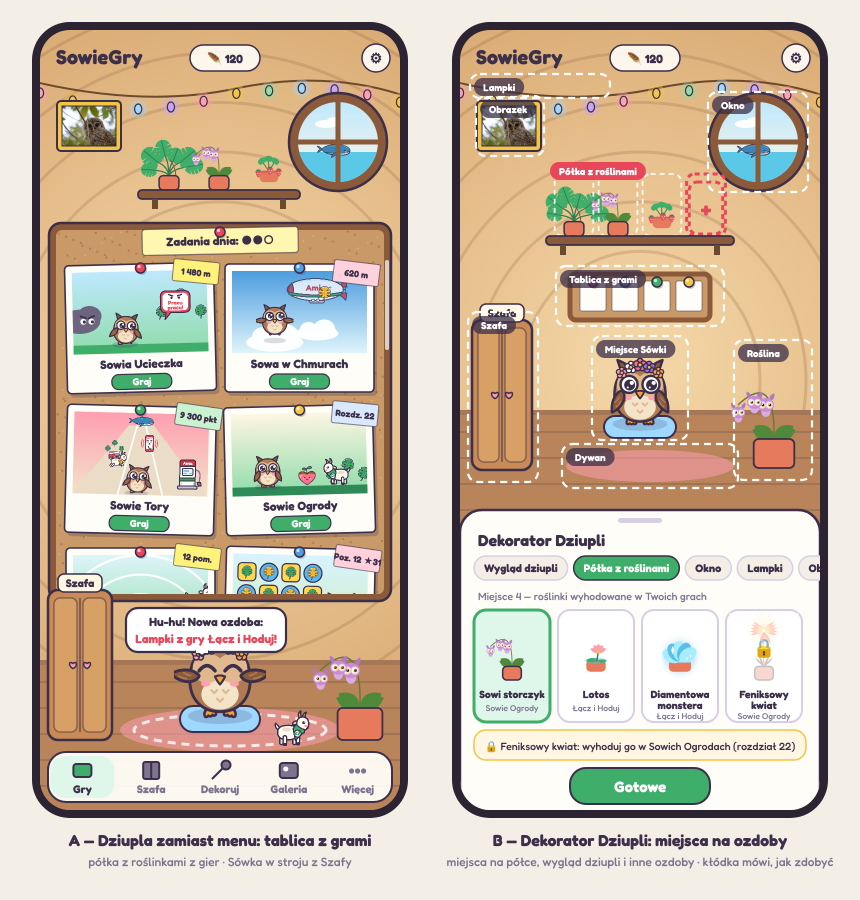

# Analiza 7 — Sowia Dziupla: nowy ekran główny SowieGry

> Data: 2026-11-22 · Podstawa: decyzja właściciela nr 7 do Analizy 5 i dwie wiadomości uzupełniające z tego samego
> dnia (dosłownie w [rozdziale 1](#1-prośba-dosłownie-i-numer)) oraz kod na `main` (menu `index.html`, `shared/menu/`,
> Sowi Butik `shared/meta/shop.js`, Galeria `shared/owl-gallery.js`) · Status: **analiza — bez zmian w kodzie**;
> budowa to osobne zadanie (proponuję po nowej grze Sowie Trójki — [rozdział 15](#15-plan-prac)) · Zasady pracy bez
> zmian: [`ANALIZA_3_Plan_prac.md`, rozdz. 8.1](ANALIZA_3_Plan_prac.md); zasada „nic nie ginie”:
> [`ANALIZA_4`, rozdz. 2](ANALIZA_4_Uwagi_z_testow_poprawki_i_rozbudowa.md).

Makieta to **rysunek poglądowy** zrobiony z prawdziwych elementów SowieGry: ilustracje kart gier z obecnego menu,
Sówka i kózka z atlasu, rośliny narysowane tymi samymi funkcjami co w Sowich Ogrodach (Monstera, Sowi storczyk)
i w Łącz i Hoduj (Truskawka, Lotos, Diamentowa monstera), miniatura zdjęcia z Galerii. Właścicielowi podoba się
kierunek makiety, z prośbą o miejsce na co najmniej 3 roślinki — makieta ma już 3 roślinki na półce.

---

## 0. W skrócie (dla właściciela)

- **Dziupla zamiast menu:** po wejściu do SowieGry widać wnętrze sowiej dziupli. Na ścianie wisi **tablica korkowa**
  z przypiętymi kartami-zdjęciami gier (przewijana w górę i w dół) — stuknięcie „Graj” otwiera grę, jak dziś. Obok
  siedzi Sówka w stroju z **Szafy**, a wszystko dookoła to **ozdoby**, które gracz sam wybiera w **Dekoratorze
  Dziupli**.
- **Ozdoby zdobywa się, grając** we wszystkie gry (te same liczniki, które dziś odblokowują zdjęcia w Galerii),
  a część można kupić za piórka. Dziupla jest **niezależna od gier** — gry tylko dają ozdoby.
- **Półka z roślinkami z gier:** co najmniej **3 miejsca** od początku (4. i 5. do odblokowania). Na każde miejsce
  gracz wybiera roślinkę wyhodowaną w Sowich Ogrodach, Łącz i Hoduj albo w Sowich Trójkach — narysowaną dokładnie
  tak jak w grze (Sowi storczyk mruga także na półce).
- **Wygląd dziupli też jest ozdobą do wyboru** (jasne drewno, brzozowa, wiśniowa, zimowa, morska, nocna,
  storczykowa…), podobnie jak widok za oknem, lampki, obrazek ze zdjęciem z Galerii, dywan, miejsce Sówki,
  zabawka i wygląd szafy.
- **Nic nie ginie:** stroje, gatunki sów, piórka, zdjęcia, rekordy i zadania zostają — zmienia się tylko to, gdzie są
  na ekranie. Zapis w profilu (jedno nowe pole), **bez zmiany reguł Firestore**.
- **Bez ryzyka:** najpierw podgląd (przycisk „Wypróbuj Sowią Dziuplę”, obecne menu zostaje), dopiero po Twojej
  akceptacji Dziupla staje się ekranem głównym.
- **Plan:** 8 etapów (D0–D7), ok. 10–14 dni pracy, jako osobne zadanie **po nowej grze Sowie Trójki** (tablica będzie
  miała od razu 6 gier). **8 pytań** prostym językiem: [rozdział 16](#16-pytania-do-właściciela-prostym-językiem).



---

## 1. Prośba (dosłownie) i numer

Numer z [`UWAGI_WLASCICIELA.md`](UWAGI_WLASCICIELA.md): **D1** (Dziupla).

| Data | Wiadomość (dosłownie) |
| --- | --- |
| 2026-11-22 | „„Sowia Dziupla” to fajny feature, który powinien być niezależny od gier. Znaczy grając w gry odblokowuje się itemy a potem dekoruje dziuplę. Dziupla zastąpiłaby obecne menu główne. To znaczy gdzieś na ekranie byłoby przewijane menu (np. coś jak tablica korkowa wewnątrz dziupli), na której gracz by wybierał grę. Garderoba/szafa do zmiany wyglądy sówki itd. Elementy dekoracyjne gracz by sam wybierał przez menu „Dekorator Dziupli”. Przeprowadź dodatkową analizę dotyczącą wprowadzenia takiej funkcjonalności.” |
| 2026-11-22 | „W „Sowiej Dziupli” elementami dekoracyjnymi mają być m.in. roślinki z innych gier ustawiane na półce. Mają to być „sloty” i gracz będzie wybierać z dostępnych co tam wstawić. Sam wygląd dziupli też ma być jednym z takich elementów dekoracyjnych do wyboru.” |
| 2026-11-22 | „Podoba mi się kierunek z makiety. Tylko zrób miejsce na przyjnajmniej 3 roślinki.” |

| Wymaganie | Gdzie w projekcie |
| --- | --- |
| niezależna od gier, przedmioty odblokowywane graniem | rozdz. 6.4, Załącznik A |
| dziupla zastępuje menu główne | rozdz. 3, 4, 8, 12 |
| przewijana tablica korkowa z grami | rozdz. 4.2 |
| szafa do zmiany wyglądu Sówki | rozdz. 5 |
| „Dekorator Dziupli” — gracz sam wybiera ozdoby | rozdz. 6 |
| roślinki z innych gier na półce, w miejscach (slotach) | rozdz. 6.2 |
| wygląd dziupli jako ozdoba do wyboru | rozdz. 6.3 |
| miejsce na co najmniej 3 roślinki | rozdz. 6.2 (3 od początku, do 5) i makieta |

---

## 2. Jak jest dziś

Menu główne (`index.html`, `shared/menu/`): nagłówek (logo, stan zapisu, ustawienia), Sówka z dymkiem i postępem zadań
dnia, cztery zakładki na dole:

| Zakładka | Co zawiera | Gdzie będzie w Dziupli |
| --- | --- | --- |
| **Gry** | 5 kart gier na krętej ścieżce (ilustracja, opis, rekord, „Graj”, „Jak grać?”), karta „Zainstaluj SowieGry” | **tablica korkowa** (karty-zdjęcia z rekordem na karteczce); karteczka „Zainstaluj” przypięta na tablicy |
| **Jak grać** | instrukcje gier i „Poznaj Sowi Świat” | „?” na każdej karcie gry + „Więcej → Jak grać” (książka na półce) |
| **Galeria** | 40 zdjęć sów, filtry, przeglądarka | zakładka „Galeria” na dole + obrazek na ścianie (wybrane zdjęcie w ramce) |
| **Sowa** | poziom, XP, piórka; Garderoba; Zadania; Osiągnięcia; Sowi Butik (gatunki, stroje, dłuższe kózki); Rekordy; Ustawienia | piórka w pasku u góry; **Szafa** (gatunki i stroje — z zakupem); „Więcej”: Sowia Akademia (poziom, zadania, osiągnięcia), Rekordy, Sowi Butik (kózki), Ustawienia; zadania dnia także na karteczce na tablicy |

Budżet obecnego menu (pomiar z E9e): ok. 218 KB po kompresji, gotowe po ok. 0,65 s przy CPU ×4; ilustracje kart
rysowane 30 razy na sekundę.

---

## 3. Pomysł

**Sowia Dziupla** to przytulne wnętrze sowiej dziupli — dom Sówki i ekran startowy wszystkich gier. Gracz wchodzi,
widzi swoją Sówkę w wybranym stroju, swoje ozdoby zdobyte w grach i tablicę z grami. Każda gra „przynosi” do dziupli
coś od siebie (roślinki z ogrodu i szklarni, widok na ocean po przygodach z humbakiem, lampkę-chmurkę ze Sowy
w Chmurach…), więc dziupla pokazuje, w co i jak dużo się grało — i zachęca do zajrzenia do innych gier.

Zasady:

1. **Granie jest najważniejsze:** gra startuje jednym stuknięciem z tablicy, tak jak dziś.
2. **Dziupla jest niezależna od gier:** to wspólna warstwa SowieGry (jak Akademia i Galeria); gry nic o niej nie
   wiedzą, tylko wysyłają zdarzenia i liczniki, z których Dziupla liczy, co jest odblokowane.
3. **Gracz decyduje:** wszystko poza tablicą z grami to miejsca (sloty) na ozdoby wybierane w Dekoratorze.
4. **Styl Sowiego Świata** i styl ulubiony przez gracza: **mrugające sówki jako kwiaty** (`docs/Documentation.md`,
   „Styl ulubiony przez gracza”).

---

## 4. Ekran

### 4.1. Telefon w pionie (podstawa — makieta A)

```
┌──────────────────────────────┐
│ SowieGry      🪶 120      ⚙  │  logo, piórka (stuknięcie → Sowia Akademia), ustawienia
│ ˚lampki˚˚˚˚˚˚˚˚˚˚˚˚˚˚˚˚˚˚˚˚   │  sufit: lampki (ozdoba)
│ [obrazek]  ═półka═  ( okno ) │  obrazek z Galerii · półka z roślinkami (3+) · okno z widokiem
│ ┌──────────────────────────┐ │
│ │  „Zadania dnia: ●●○”     │ │  karteczka zadań (stuknięcie → zadania)
│ │ ┌─────────┐ ┌─────────┐  │ │
│ │ │ Ucieczka│ │ Chmury  │  │ │  tablica korkowa: karty-zdjęcia gier,
│ │ │ [Graj]  │ │ [Graj]  │  │ │  rekord na kolorowej karteczce,
│ │ └─────────┘ └─────────┘  │ │  przewijanie w pionie
│ │   …   (6 gier)           │ │
│ └──────────────────────────┘ │
│ [szafa]   (Sówka)   🌸 🐐    │  podłoga: szafa, Sówka na swoim miejscu, roślina, zabawka, dywan
│ [Gry][Szafa][Dekoruj][Galeria][Więcej] │  dolny pasek (strefa kciuka)
└──────────────────────────────┘
```

- **Tablica korkowa** zajmuje środek ekranu (ok. 45–50% wysokości) i przewija się w pionie wewnątrz ramki; reszta
  dziupli stoi. Na telefonie od 360 px — dwie kolumny kart, na 320 px — też dwie (karta ok. 140 px; ilustracja
  ok. 126 × 70 px).
- **Dolny pasek** (5 przycisków z ikoną i podpisem, min. 48 px): Gry (tablica), Szafa, Dekoruj, Galeria, Więcej.
  Te same funkcje są też „w pokoju” (stuknięcie szafy otwiera Szafę, obrazka — Galerię, książki — Jak grać), ale
  pasek zawsze pokazuje, gdzie co jest.
- **Sówka** siedzi na swoim miejscu (poduszka, gniazdko, huśtawka… — ozdoba), mruga, oddycha, na stuknięcie
  pohukuje i się cieszy (jak w Sowich Trójkach), a w dymku mówi o postępie („Masz nową ozdobę!”, „Zostały 2 zadania
  dnia”) — z wyłączeniem przez „Komentarze sowy”.

### 4.2. Tablica korkowa z grami

- **Karta gry = przypięte zdjęcie** (polaroid): ruchoma ilustracja gry (ta sama co dziś na karcie, rysowana tylko,
  gdy karta jest widoczna), nazwa, przycisk „Graj”, mały „?” (Jak grać), rekord na kolorowej karteczce w rogu
  („1 480 m”, „Poziom 12 ★ 31”), znaczek „Nowe!”; pinezka w kolorze gry, lekkie przechylenie każdej karty.
- **Kolejność kart** jak dziś (rejestr gier), na końcu nowe gry; karteczki: „Zadania dnia: ●●○” (u góry),
  „Zainstaluj SowieGry na telefonie” (gdy nie zainstalowano), w przyszłości „Wyzwanie dnia”.
- **Przewijanie** palcem w pionie z rozpędem (jak lista), pasek przewijania na ramie tablicy; przy pierwszym wejściu
  tablica lekko „podskakuje”, żeby było widać, że się przewija.
- **Ramka tablicy i pinezki** to też ozdoby (Dekorator → „Tablica z grami”).

### 4.3. Inne ekrany i rozmiary

- **Mały telefon (320 × 568):** mniejsze okno i obrazek, półka z 3 roślinkami węższa, tablica wyższa (ok. 55%),
  podłoga niższa — Sówka ok. 70 px.
- **Telefon poziomo:** dziupla po lewej (Sówka, półka, okno, szafa), tablica po prawej na całą wysokość.
- **Tablet i komputer:** dziupla szersza, tablica w 3 kolumnach, więcej miejsc na ozdoby widocznych naraz (te same
  sloty, większe).

---

## 5. Szafa — wygląd Sówki

- Stuknięcie szafy albo „Szafa” na dole otwiera arkusz z Sówką na środku (duży podgląd na żywo) i dwiema
  zakładkami: **Gatunki** (Sówka, Puszczyk, Pójdźka, Uszatka, Płomykówka, Śnieżna, Puchacz — z Sowiego Butiku)
  i **Stroje** (13 dodatków z Garderoby).
- Zablokowane: kłódka i jak zdobyć („Misja: …” albo „Kup za 40 piórek”); zakup od razu w Szafie, z potwierdzeniem —
  ta sama logika co dziś w Sowim Butiku (`shared/meta/shop.js`: zapis po 0,3 s, dziennik zakupów `outfit:`
  i `species:` — lekcja z uwagi G3).
- Wybór widać od razu na Sówce w dziupli i we wszystkich grach (jak dziś: `cosmetics.selected`,
  `shop.species.selected`).
- Później (opcjonalnie): kolejne stroje i dodatki jako nagrody za gry.

---

## 6. Dekorator Dziupli

### 6.1. Miejsca (sloty)

| Miejsce | Co tam można wstawić | Na start |
| --- | --- | --- |
| **Wygląd dziupli** | motyw całego wnętrza: ściany, słoje drewna, podłoga, kolor ramy okna (rozdz. 6.3) | Jasne drewno |
| **Okno** | widok za oknem: Łąka, Ocean z humbakiem, Chmury, Nocne niebo, Miasto, Ogród, Staw… albo „Automatyczny” (rano, dzień, wieczór, noc według zegara) | Łąka |
| **Sufit** | lampki, lampa-chmurka, księżyc, girlanda z liści | żarówka |
| **Obrazek** | dowolne odblokowane zdjęcie z Galerii + ramka (drewniana, złota, kwiatowa) | zdjęcie nr 1, ramka drewniana |
| **Półka z roślinkami** — miejsca 1–3, **4 i 5 do odblokowania** | roślinki wyhodowane w grach (rozdz. 6.2) | Monstera (z Sowich Ogrodów) na miejscu 1, miejsca 2–3 puste z „+” |
| **Tablica z grami** | ramka (korek, liście, chmurka), pinezki (kolorowe, serduszka, gwiazdki) | korek, kolorowe pinezki |
| **Szafa** | wygląd szafy (drewniana, w kwiatki, szafa-humbak) | drewniana |
| **Miejsce Sówki** | poduszka, gniazdko, huśtawka, hamak, fotel-grzybek | poduszka |
| **Dywan** | różowy okrągły, liść Monstery, w kózki, tęczowy | różowy |
| **Duża roślina na podłodze** | Monstera w donicy, Sowi storczyk (duży), Kozi liść, Humbakowiec, Pisklęce pąki | Monstera |
| **Zabawka** | kózka-pluszak, humbak-pluszak, pociąg z Sowich Torów, „telefon Pracu na smyczy” | brak |

Każde miejsce ma też wybór „pusto” (oprócz wyglądu dziupli i tablicy). Ozdoba może pasować tylko do swojego miejsca
(np. widok tylko do okna) — w ten sposób nic się nie nakłada i wszystko dobrze wygląda na każdym telefonie.

### 6.2. Półka z roślinkami z gier

- **Miejsca:** 3 od początku (właściciel: „przynajmniej 3 roślinki”), **4. miejsce** po 5. poziomie Sowiej Akademii,
  **5. miejsce** po ukończeniu 14. rozdziału Sowich Ogrodów — półka rośnie razem z graczem.
- **Skąd roślinki** (gracz wybiera z odblokowanych, każdą można postawić na dowolnym miejscu, ta sama roślinka może
  stać na dwóch miejscach):

| Gra | Roślinki | Kiedy dostępne | Jak wyglądają |
| --- | --- | --- | --- |
| Sowie Ogrody | 43 gatunki (od Monstery po Drzewo życia, także Sowi storczyk, Belladonna, Mandragora…) | gatunek z rozdziału, do którego gracz doszedł (rozdziały zostają po Wielkim Przesadzaniu, więc roślinka nie znika) | rysunek z gry (`SowieOgrody/ogrod/plants.js`) w doniczce z ogrodu; wygląd „bujny” (etap 4–5); ruchome elementy jak w ogrodzie (Sowi storczyk mruga i się rozgląda) |
| Łącz i Hoduj | 9 łańcuchów (Monstera, Pilea, Paproć, Kaktus, Storczyk, Słonecznik, Truskawka, Lotos, Baobab), poziomy 3–7 (złote, diamentowe, tęczowe) i hybrydy | łańcuch odblokowany w Sowiej doniczce; poziom złoty / diamentowy / tęczowy i hybryda — po wyhodowaniu | rysunek z gry (`LaczIHoduj/plants.js`) z doniczką; iskierki przy złotych, diamentowych i tęczowych |
| Sowie Trójki | Truskawka, Storczyk z sowią buzią (styl ulubiony), później kolejne | po rozdziałach gry | ikona kafelka jako roślinka w doniczce |
| nowe (styl ulubiony) | Kozi liść, Humbakowiec, Pisklęce pąki | za cele w grach (Załącznik A) | nowe rysunki „mrugająca sówka jako kwiat” |

- **Dekorator półki:** stuknięcie miejsca → arkusz z kategoriami (Sowie Ogrody, Łącz i Hoduj, Sowie Trójki,
  Specjalne) i kafelkami roślinek z podpisem gry; zablokowane z kłódką i opisem („Wyhoduj w Sowich Ogrodach —
  rozdział 22”) oraz paskiem postępu, jeśli da się go policzyć.
- **Dlaczego to dobre:** rośliny już są narysowane w grach (żadnych nowych grafik dla ponad 100 wariantów), a gracz
  widzi w dziupli swoje osiągnięcia z ogrodu i szklarni.

### 6.3. Wygląd dziupli (motyw) — też do wyboru

| Motyw | Wygląd | Jak zdobyć |
| --- | --- | --- |
| Jasne drewno | ciepłe drewno ze słojami (jak na makiecie) | od początku |
| Brzozowa | jasna kora w ciemne kreski, zielone listki przy oknie | 3. poziom Akademii |
| Wiśniowa | różowe drewno, płatki sakury | Sowie Ogrody: rozdział 9 (Ogród japoński) |
| Zimowa | szron na ścianach, śnieżynki, ciepły szalik na haczyku | Sowa w Chmurach: 1000 m |
| Morska | niebieskie fale na ścianie, bąbelki, okrągłe „bulaje” | 10 przygód z humbakiem we wszystkich grach |
| Nocna | granatowe ściany ze świecącymi gwiazdkami | Sowa w Chmurach: 1900 m (Mgławica) |
| Szklarniana | szklane ściany, liście i krople na szybach | Łącz i Hoduj: 10 pomieszczeń |
| Storczykowa | różowo-fioletowa, z mrugającymi kwiatami-sówkami na ścianach (styl ulubiony) | Sowie Ogrody: 10 Sowich storczyków albo 100 piórek |
| Drzewo świata | złociste słoje i świetliki | Sowie Ogrody: rozdział 22 |

Motyw zmienia wygląd ścian i podłogi, ale nie zasłania ozdób — wszystkie sloty są w tych samych miejscach.

### 6.4. Jak się zdobywa ozdoby

1. **Granie** — te same liczniki Sowiej Akademii, które dziś odblokowują zdjęcia w Galerii (np. `runnerDistance`,
   `jumperHeight`, `goatsCaught`, `ogrodyChapters`, `szklarniaRooms`, `level`, `achievements`) i podsumowania gier
   w profilu (rozdział Sowich Ogrodów, pomieszczenia w Łącz i Hoduj, poziomy i gwiazdki w Sowich Trójkach). Warunek
   zapisany w tym samym formacie co wymagania zdjęć (`goals: [["jumperHeight", 1500]]`), liczony tą samą funkcją
   postępu — także pasek postępu przy kłódce.
2. **Osiągnięcia Akademii** — część ozdób jako nagroda za konkretne osiągnięcia.
3. **Piórka** — część ozdób (zwłaszcza motywy i dywany) można kupić w Dekoratorze, jak stroje w Butiku; zakup
   w dzienniku `shop.purchases["decor:<ozdoba>"]` (zapisywany po jednym kluczu — nie ginie, lekcja z uwagi G3).
4. **Galeria** — każde odblokowane zdjęcie można powiesić w ramce.
5. **Później** — ozdoby sezonowe (np. lampki w grudniu) i nagrody za wyzwania dnia.

Odblokowanie **wynika z postępu**, a nie jest osobno zapisywane — nie trzeba niczego przenosić, a ozdoba nie może
„zniknąć” (liczniki tylko rosną). Nowe ozdoby dostają znaczek „Nowe!”, a Sówka mówi o nich w dymku.

### 6.5. Jak działa Dekorator

1. „Dekoruj” na dole → dziupla „oddala się”, tablica zwija się do małej ramki, miejsca podświetlają się
   przerywaną linią z podpisem (makieta B).
2. Stuknięcie miejsca → arkusz od dołu z kategoriami (Wygląd dziupli, Półka z roślinkami, Okno, Sufit, Obrazek…)
   i kafelkami ozdób; wybór widać od razu na podglądzie.
3. Zablokowana ozdoba: kłódka, warunek prostymi słowami i postęp („Wzleć na 1500 m w Sowie w Chmurach — 1120 / 1500”);
   ozdoba za piórka: cena i „Kup” (z potwierdzeniem).
4. „Gotowe” zapisuje zmiany (jeden zapis profilu po ok. 1 s), „Przywróć domyślne” na końcu listy każdego miejsca.

---

## 7. Sówka w Dziupli

- Animacja jak dziś w menu (mruganie, oddech) plus reakcje na stuknięcie (podskok, obrót, „hu-hu!”) — ten sam
  „reżyser reakcji” co w Sowich Trójkach (Analiza 5, rozdz. 8.7), przeniesiony do wspólnego `shared/world/`, gdy
  powstanie Dziupla.
- **Powitanie** zależne od pory dnia i postępu: „Dzień dobry! Masz nową ozdobę: lampki z Łącz i Hoduj!”, „Zostały
  2 zadania dnia”, „Dawno nie było nas w ogrodzie — rośliny urosły!” (krótko, najwyżej raz na wejście; wyłączane
  przez „Komentarze sowy”).
- Sówka siedzi na wybranym miejscu (poduszka, gniazdko, huśtawka…) — na huśtawce się buja, w hamaku drzemie.

---

## 8. Co z resztą menu — mapa funkcji

| Dziś | W Dziupli | Adres (zakładki z linku działają dalej) |
| --- | --- | --- |
| Gry | tablica korkowa (ekran startowy) | `…/` |
| Jak grać | „?” na karcie gry, „Więcej → Jak grać”, książka na półce | `#jak-grac`, `#jak-grac-<gra>` |
| Galeria | „Galeria” na dole, obrazek na ścianie | `#galeria` |
| Sowa → poziom, XP, piórka | piórka w pasku u góry → Sowia Akademia | `#sowa` → Sowia Akademia |
| Sowa → Garderoba, Sowi Butik (gatunki, stroje) | **Szafa** | `#szafa` (nowy) |
| Sowa → Sowi Butik (dłuższe kózki) | „Więcej → Sowi Butik” | — |
| Sowa → Zadania, Osiągnięcia | karteczka na tablicy, „Więcej → Sowia Akademia” | — |
| Sowa → Rekordy | „Więcej → Rekordy” (i karteczki z rekordami na kartach gier) | — |
| Sowa → Ustawienia | ⚙ u góry, „Więcej → Ustawienia” | `#ustawienia` |
| — | Dekorator Dziupli | `#dekorator` (nowy) |
| Wersja demo (`demo.html`) | **bez zmian** — własne, proste menu (pytanie 6) | — |

---

## 9. Dane i zapis

- **Nowe pole profilu** `profil.dziupla` (profil ma dziś 13 pól najwyższego poziomu, reguły pozwalają na 30 —
  **reguły Firestore bez zmian**):

```js
dziupla: {
  version: 1,
  placed: {                       // miejsce → ozdoba (zapis po jednym kluczu — dwa telefony zmieniające różne
    wyglad: "jasne-drewno",       // miejsca nie nadpisują sobie zmian)
    okno: "ocean",
    sufit: "lampki",
    obrazek: "owl-21|zlota",
    "polka-1": "ogrody:monstera",
    "polka-2": "ogrody:sowiStorczyk",
    "polka-3": "lacz:truskawka:4",
    tablica: "korek|serduszka",
    szafa: "drewniana",
    miejsce: "poduszka",
    dywan: "rozowy",
    roslina: "monstera-duza",
    zabawka: "kozka",
  },
  seen: { "okno:ocean": 1795000000000 }   // „Nowe!” znika po obejrzeniu (mapa, nie tablica — lekcja z G3)
}
```

- **Zakupy** w istniejącym dzienniku `shop.purchases["decor:<ozdoba>"]`, piórka przez `SowieAcademy.spend` — jak
  w Sowim Butiku.
- **Odblokowane ozdoby nie są zapisywane** — wynikają z postępu (rozdz. 6.4). Do podsumowań gier w profilu
  (`profil.records.<gra>`, zapisywanych już dziś przez `saveGameState`) dopisujemy tylko brakujące drobiazgi,
  np. w Łącz i Hoduj liczbę połączeń (odblokowane łańcuchy) i najlepszy poziom w każdym łańcuchu.
- **Zasada „nic nie ginie”:** nieznana ozdoba (np. zapis z nowszej wersji na drugim telefonie) zostaje w zapisie
  i jest pokazywana jako domyślna dla miejsca, dopóki ta wersja jej nie zna; nic nie jest kasowane.
- **Bezpieczeństwo produkcji:** testy tylko na emulatorze i w pamięci; zmiana nie dotyka dokumentów gier ani reguł;
  zapis Dziupli to zwykła zmiana profilu (ta sama droga co ustawienia).

---

## 10. Technika

- **Pokój z elementów strony (DOM) zamiast płótna:** tło (motyw) i ozdoby jako obrazki SVG w warstwach, ułożone
  w stałej „scenie” skalowanej do ekranu; każda ozdoba w slocie to przycisk z opisem (dostępność, łatwe stuknięcie).
  Przeglądarka składa nieruchome obrazki kartą graficzną — **bez rysowania co klatkę** (wniosek z Analizy 6).
- **Animacje** lekkie i w CSS (lampki, kołysanie, migotanie gwiazd), wyłączane przy ograniczeniu ruchu.
- **Płótna tylko tam, gdzie trzeba:** Sówka (atlas, gatunek z Butiku), ilustracje kart na tablicy (rysowane tylko
  widoczne karty, 30 klatek/s, jak dziś w menu) i roślinki na półce (małe płótna; rysunek z gry; mruganie Sowiego
  storczyka ok. 12 klatek/s — wystarczy, a kosztuje mało).
- **Wspólny automat płynności i limit 60 klatek/s** z Analizy 6 (W1); licznik `?perf=1` działa też w Dziupli.
- **Ładowanie:** podstawowy pokój (motyw domyślny, okno, półka, szafa) w pamięci aplikacji (`sw.js`), pozostałe
  ozdoby pobierane dopiero, gdy są ustawione albo oglądane w Dekoratorze. Cel na telefonie odniesienia (Redmi Note
  10 Pro, Chrome): Dziupla gotowa w ≤ 1 s, w spokoju wątek strony zajęty ≤ 30%.
- **Nowe moduły:** `shared/dziupla/items.js` (katalog miejsc i ozdób z warunkami), `state.js` (odczyt i normalizacja
  `profil.dziupla`, liczenie odblokowanych z profilu, Akademii, Galerii i Butiku), `room.js` (scena), `board.js`
  (tablica korkowa — korzysta z `shared/menu/games.js`), `wardrobe.js` (Szafa — logika z `owl-tab.js` i `shop.js`),
  `decorator.js` (Dekorator), `plants.js` (roślinki z gier na małych płótnach), `dziupla.css`; zmiany w
  `shared/menu/menu.js` (przełącznik podglądu, potem ekran główny) i `index.html`.

---

## 11. Grafika

- **Styl Sowiego Świata** (kontur `#3b2f4a`, paleta, zaokrąglenia) i **styl ulubiony** — mrugające sówki jako kwiaty
  (motyw „Storczykowa”, roślinki Kozi liść, Humbakowiec, Pisklęce pąki).
- **Nowe pliki SVG** w `assets/svg/dziupla/` (ok. 35–45 małych plików, razem ok. 60–100 KB): motywy (ściany
  i podłoga), widoki za oknem, lampy, ramki, tablica i pinezki, szafy, miejsca Sówki, dywany, duże rośliny, zabawki.
- **Bez nowych rysunków** dla roślinek z gier (rysunki z Sowich Ogrodów i Łącz i Hoduj) i zdjęć (Galeria).
- Każda nowa grafika najpierw na obrazku do Twojej akceptacji (jak makieta), potem w kodzie.

---

## 12. Wprowadzenie bez ryzyka

1. **Podgląd:** w obecnym menu (Sowa → Ustawienia) przycisk „Wypróbuj Sowią Dziuplę” — otwiera Dziuplę, a z niej
   można wrócić do zwykłego menu. Obecne menu zostaje ekranem startowym.
2. **Twoje testy na telefonie** (rozdz. 13.4) i poprawki.
3. **Przełączenie:** po Twojej zgodzie Dziupla staje się ekranem startowym; zwykłe menu zostaje jako „Prosty widok”
   w ustawieniach na czas testów rodziny (pytanie 1).
4. **Wersja demo** bez zmian (pytanie 6).

---

## 13. Testy

### 13.1. Jednostkowe

- Katalog: unikalne identyfikatory, każde miejsce ma ozdobę domyślną, warunki odwołują się do istniejących liczników
  Akademii (ten sam test co wymagania zdjęć Galerii), ceny dodatnie, każda ozdoba ma plik grafiki.
- Odblokowanie z przykładowych profili (nowy gracz, gracz po 22 rozdziałach Ogrodów, po zakupach w Butiku):
  właściwe ozdoby i roślinki, 3 → 4 → 5 miejsc na półce.
- Normalizacja `profil.dziupla`: brak pola, uszkodzone, z nieznaną ozdobą (zostaje), ozdoba w złym miejscu.
- Zakup za piórka: odjęte piórka, wpis w dzienniku, druga próba nie pobiera drugi raz.
- Profil po zmianach ma ≤ 30 pól najwyższego poziomu (reguła Firestore).

### 13.2. W przeglądarce (Playwright, profile telefonów, Chromium + WebKit w CI)

1. Podgląd z ustawień: Dziupla się otwiera bez błędów; tablica ma 6 kart; „Graj” otwiera grę; „?” pokazuje
   instrukcję; powrót do zwykłego menu.
2. Szafa: zmiana stroju i gatunku widoczna na Sówce w dziupli i w grze.
3. Dekorator: ustawienie roślinki na miejscu 2 i widoku w oknie → odświeżenie → zostają (emulator Firestore).
4. Zablokowana ozdoba: kłódka i warunek; zakup za piórka.
5. Adresy `#galeria`, `#jak-grac-runner`, `#ustawienia`, `#szafa`, `#dekorator`.
6. 320 × 568 i telefon poziomo: nic się nie nakłada, tablica przewija się palcem, dolny pasek widoczny.
7. Ograniczenie ruchu: bez animacji lampek i kołysania.

### 13.3. Wydajność

Skrypt pomiarowy z Analizy 6 (W7) z profilem „Redmi Note 10 Pro”: start, przewijanie tablicy, otwarcie Dekoratora;
w CI — liczniki pracy (ile płócien rysuje się w spokoju) zamiast liczenia klatek.

### 13.4. Na telefonie (dla Ciebie, prostym językiem — dopiszę do `TESTY_NA_TELEFONIE.md`)

| Test | Co sprawdzasz |
| --- | --- |
| D1 | wejście do Dziupli, przewijanie tablicy, start każdej gry |
| D2 | Szafa: strój i gatunek widać w dziupli i w grach |
| D3 | Dekorator: 3 roślinki na półce, widok za oknem, wygląd dziupli — zostają po zamknięciu aplikacji |
| D4 | kłódki: czy opis „jak zdobyć” jest zrozumiały; zakup za piórka |
| D5 | płynność na Redmi Note 10 Pro (`?perf=1`) i mały telefon / poziomo |

---

## 14. Ryzyka

| Ryzyko | Skutek | Jak zapobiegamy |
| --- | --- | --- |
| Zmiana ekranu startowego wszystkich gier | trudniej znaleźć grę, błąd blokuje wejście | podgląd przy zachowaniu obecnego menu; gra zawsze 1 stuknięcie z tablicy; testy e2e startu każdej gry; „Prosty widok” |
| Dużo grafik | długa praca | rośliny i zdjęcia z gier (bez nowych rysunków), na start ok. 35–45 małych SVG, reszta później |
| Za mało miejsca na małym telefonie | ozdoby się nakładają | stałe miejsca (sloty), układ dla 320 px i poziomo, test nakładania prostokątów |
| Wolniejszy start menu | lagi na słabszych telefonach | pokój z obrazków bez rysowania co klatkę, leniwe ładowanie ozdób, budżet w rozdz. 10 |
| Gracz nie wie, skąd brać ozdoby | zniechęcenie | kłódka z prostym warunkiem i postępem, Sówka mówi o nowościach, znaczek „Nowe!” |
| Dwa telefony zmieniają dekoracje | nadpisanie | zapis po jednym miejscu (klucz), ostatnia zmiana danego miejsca wygrywa, inne miejsca bez zmian |
| Wiele testów zależy od dzisiejszego menu | czerwone testy przy przełączeniu | przełączenie jako osobny krok z aktualizacją testów (`menu.spec.js`, `smoke.spec.js` i in.) |
| Profil rośnie | limit reguły 30 pól | jedno nowe pole; test liczby pól |

---

## 15. Plan prac

| Etap | Co | Rozmiar |
| --- | --- | --- |
| **D0** | decyzje (rozdz. 16), akceptacja makiety — ta analiza | S |
| **D1** | katalog miejsc i ozdób, liczenie odblokowanych, `profil.dziupla`, zakupy + testy jednostkowe | M (2 dni) |
| **D2** | scena dziupli (motyw domyślny), tablica korkowa z kartami gier, dolny pasek, Sówka — jako podgląd | L (3 dni) |
| **D3** | Szafa (gatunki i stroje z zakupem) | M (1 dzień) |
| **D4** | Dekorator: miejsca, arkusz, kłódki i postęp, zakup za piórka; półka z roślinkami z gier (3–5 miejsc) | M–L (2–3 dni) |
| **D5** | grafiki: motywy, widoki, ozdoby (ok. 35–45 SVG; najpierw obrazek do akceptacji) | L (2–3 dni) |
| **D6** | „Więcej” (Akademia, Rekordy, Jak grać, Butik, Ustawienia), adresy, karteczki zadań i instalacji, powitania Sówki | M (1–2 dni) |
| **D7** | przełączenie ekranu startowego po Twojej zgodzie, „Prosty widok”, aktualizacja testów i dokumentacji (`docs/README.md`, `docs/Documentation.md`) | M (1–2 dni) |

Razem ok. 10–14 dni. **Kiedy:** jako osobne zadanie **po** obecnym (dokumentacja → wydajność → Sowie Trójki), żeby
tablica od razu miała 6 gier, a Dziupla korzystała z poprawek wydajności i reżysera reakcji Sówki z Sowich Trójek
(pytanie 7).

**Twoje czynności:** odpowiedzi na pytania, akceptacja grafik (D5), testy D1–D5 na telefonie, zgoda na przełączenie
(D7). **Reguły Firestore — bez zmian.**

---

## 16. Pytania do właściciela (prostym językiem)

1. **Czy po przejściu na Dziuplę zostawić w ustawieniach „Prosty widok”** (obecne menu z listą gier) — na czas testów
   rodziny? (**Polecam:** tak, na kilka tygodni, potem usunąć, żeby nie utrzymywać dwóch menu.)
2. **Tablica z grami przewijana w górę i w dół, karty w dwóch kolumnach** (jak na obrazku)? Czy wolisz przesuwanie
   w bok, jak kartki w albumie? (**Polecam:** w górę i w dół.)
3. **Półka:** 3 miejsca od początku, 4. i 5. do zdobycia w grach — dobrze? (**Polecam:** tak.)
4. **Skąd ozdoby:** głównie za granie, a część (np. wygląd dziupli, dywany) także za piórka — dobrze? (**Polecam:**
   tak — piórka dostają nowe zastosowanie.)
5. **Widok za oknem może się sam zmieniać z porą dnia** (rano, dzień, wieczór, noc), jeśli wybierzesz „Automatyczny”?
   (**Polecam:** tak.)
6. **Wersja demo** zostaje z prostym menu, bez Dziupli? (**Polecam:** tak.)
7. **Kolejność:** Dziupla jako osobne zadanie po nowej grze Sowie Trójki? (**Polecam:** tak.)
8. **Masz pomysły na ozdoby?** Np. konkretne zabawki, obrazki, rośliny, przedmioty z gier — dopiszę do katalogu
   (Załącznik A). Można odpowiedzieć „zdaję się na Ciebie”.

---

## Załącznik A. Proponowany katalog ozdób (pierwsza wersja)

Warunki w formacie wymagań Galerii (liczniki Sowiej Akademii i podsumowania gier); ceny w piórkach. Liczby do
ustalenia w D1 (tak, żeby co tydzień grania przybywało 2–3 ozdób).

| Miejsce | Ozdoba | Jak zdobyć |
| --- | --- | --- |
| Wygląd dziupli | Jasne drewno · Brzozowa · Wiśniowa · Zimowa · Morska · Nocna · Szklarniana · Storczykowa · Drzewo świata | rozdz. 6.3 |
| Okno | Łąka · Ocean z humbakiem · Chmury · Nocne niebo · Miasto · Ogród · Staw · Automatyczny | od początku · 3 przygody z humbakiem · Sowa w Chmurach 500 m · 1500 m · ukończona kampania Sowich Torów · Sowie Ogrody rozdział 6 · Sowie Trójki rozdział 3 · od początku |
| Sufit | Żarówka · Kolorowe lampki · Lampa-chmurka · Księżyc · Girlanda z liści | od początku · Łącz i Hoduj 6 pomieszczeń · Sowa w Chmurach 300 m · Sowie Ogrody: Księżycowy ogród · 300 liści w grach zręcznościowych |
| Obrazek | dowolne odblokowane zdjęcie z Galerii; ramki: drewniana · złota · kwiatowa | od początku · 8 osiągnięć · 40 piórek |
| Półka z roślinkami | roślinki z Sowich Ogrodów, Łącz i Hoduj, Sowich Trójek, specjalne; miejsca 4 i 5 | rozdz. 6.2; 5. poziom Akademii · Sowie Ogrody rozdział 14 |
| Tablica z grami | ramka: korek · liście · chmurka; pinezki: kolorowe · serduszka · gwiazdki | od początku · 3 osiągnięcia · Sowa w Chmurach 750 m; od początku · 20 piórek · 30 piórek |
| Szafa | drewniana · w kwiatki · szafa-humbak | od początku · 30 piórek · 5 przygód z humbakiem |
| Miejsce Sówki | poduszka · gniazdko · huśtawka · hamak · fotel-grzybek | od początku · Sowie Trójki: 10 piskląt · Sowa w Chmurach 750 m · Sowie Ogrody rozdział 10 · Sowie Ogrody: Muchomor |
| Dywan | różowy · liść Monstery · w kózki · tęczowy | od początku · Sowie Ogrody 5000 liści · złap 10 kózek · 10. poziom Akademii |
| Duża roślina | Monstera w donicy · Sowi storczyk · Kozi liść · Humbakowiec · Pisklęce pąki | od początku · Sowie Ogrody: Sowi storczyk · Sowie Trójki rozdział 1 · 5 przygód z humbakiem · Sowie Trójki: 10 piskląt |
| Zabawka | kózka-pluszak · humbak-pluszak · pociąg · telefon Pracu na smyczy | złap 10 kózek · 3 przygody z humbakiem · Sowie Tory: 4. plansza · Łącz i Hoduj: 20 karteczek Pracu |
